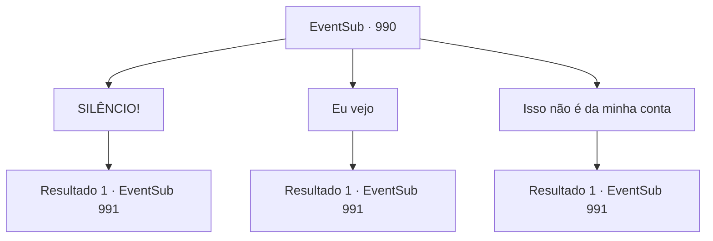

# Eventos secundários · 990

[Índice da tabela](index.md) · [Índice geral](../index.md)

ID: `pt:EventSub:990` · Fonte: `EventSub4` · Versão: 1.2.47.

Mapeamento estático dos arquivos; a disponibilidade e a execução dependem do estado da run.

## Texto do evento

*Sem texto no arquivo.*

## Dados de entrada

```json
{
  "id": 990,
  "grade": 1,
  "subEvent": "",
  "required": ""
}
```

## Mapa das escolhas



## Escolhas e resultados

### Escolha 1

SILÊNCIO!

Requisitos e outros campos da escolha:

```json
{
  "required": ""
}
```

#### Resultado 1.1

Lukas sorri amargamente. 

 "No final, cabe a você. Mas eu tenho uma alta consideração por suas habilidades, aventureiro. Então estou lhe dando uma última chance de ficar do meu lado."

 O homem parado perto de Lukas avança e continua. 

 "Com Edward fora, o filho da Senhora Hazel - que ela dará à luz em breve - se tornará o próximo herdeiro na linha de sucessão. Quando isso acontecer, garantiremos a você um lugar no conselho de conselheiros do Condado de Ronan."


Continuação registrada: [Evento 991](0991.md) na mesma tabela.

```json
{
  "required": "",
  "chance": "1",
  "nextEvent": 991,
  "type": 2,
  "reward": ""
}
```

### Escolha 2

Eu vejo

Requisitos e outros campos da escolha:

```json
{
  "required": ""
}
```

#### Resultado 2.1

Lukas sorri, satisfeito. 

 "No final, a decisão é sua. Eu vi você lutar - tenho grande consideração por suas habilidades, aventureiro. Então estou lhe dando uma última chance de ficar do meu lado."

 O homem parado perto de Lukas se adianta e continua. 

 "Com Edward fora, o filho da Senhora Hazel - que ela dará à luz em breve - se tornará o próximo herdeiro na linha de sucessão. Quando isso acontecer, garantiremos a você um lugar no conselho de conselheiros do Condado de Ronan."


Continuação registrada: [Evento 991](0991.md) na mesma tabela.

```json
{
  "required": "",
  "chance": "1",
  "nextEvent": 991,
  "type": 2,
  "reward": ""
}
```

### Escolha 3

Isso não é da minha conta

Requisitos e outros campos da escolha:

```json
{
  "required": ""
}
```

#### Resultado 3.1

Lukas sorri amargamente. 

 "No final, cabe a você. Mas eu tenho uma alta consideração por suas habilidades, aventureiro. Então estou lhe dando uma última chance de ficar do meu lado."

 O homem parado perto de Lukas avança e continua. 

 "Com Edward fora, o filho da Senhora Hazel - que ela dará à luz em breve - se tornará o próximo herdeiro na linha de sucessão. Quando isso acontecer, garantiremos a você um lugar no conselho de conselheiros do Condado de Ronan."


Continuação registrada: [Evento 991](0991.md) na mesma tabela.

```json
{
  "required": "",
  "chance": "1",
  "nextEvent": 991,
  "type": 2,
  "reward": ""
}
```

## Referências que chegam a este evento

- [Evento 989 · escolha 1 · resultado 1](0989.md#escolha-1)
