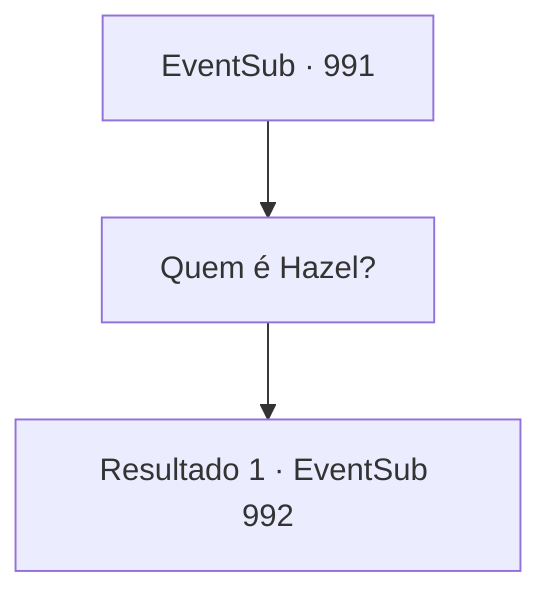

# Eventos secundários · 991

[Índice da tabela](index.md) · [Índice geral](../index.md)

ID: `pt:EventSub:991` · Fonte: `EventSub4` · Versão: 1.2.47.

Mapeamento estático dos arquivos; a disponibilidade e a execução dependem do estado da run.

## Texto do evento

*Sem texto no arquivo.*

## Dados de entrada

```json
{
  "id": 991,
  "grade": 1,
  "subEvent": "",
  "required": ""
}
```

## Mapa das escolhas



## Escolhas e resultados

### Escolha 1

Quem é Hazel?

Requisitos e outros campos da escolha:

```json
{
  "required": ""
}
```

#### Resultado 1.1

O homem com a espada larga responde. 

 "Hazel Ronan. A segunda esposa do Conde. Eu sou o irmão mais velho dela - é por isso que posso prometer a você esse lugar no conselho."


Continuação registrada: [Evento 992](0992.md) na mesma tabela.

```json
{
  "required": "",
  "chance": "1",
  "nextEvent": 992,
  "type": 2,
  "reward": ""
}
```

## Referências que chegam a este evento

- [Evento 990 · escolha 1 · resultado 1](0990.md#escolha-1)
- [Evento 990 · escolha 2 · resultado 1](0990.md#escolha-2)
- [Evento 990 · escolha 3 · resultado 1](0990.md#escolha-3)
