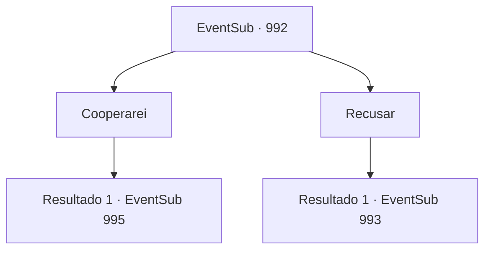

# Eventos secundários · 992

[Índice da tabela](index.md) · [Índice geral](../index.md)

ID: `pt:EventSub:992` · Fonte: `EventSub4` · Versão: 1.2.47.

Mapeamento estático dos arquivos; a disponibilidade e a execução dependem do estado da run.

## Texto do evento

*Sem texto no arquivo.*

## Dados de entrada

```json
{
  "id": 992,
  "grade": 1,
  "subEvent": "",
  "required": ""
}
```

## Mapa das escolhas



## Escolhas e resultados

### Escolha 1

Cooperarei

Requisitos e outros campos da escolha:

```json
{
  "required": ""
}
```

#### Resultado 1.1

Você informa a Lukas que está disposto a cooperar. Ele exibe um sorriso torto. 

 "Eu sabia. Eu disse que tenho um talento para avaliar pessoas."

 O homem com a espada grande elogia sua decisão sábia e se apresenta formalmente. 

 "Bom. Meu nome é Milorad. Prazer."

 Você os leva ao esconderijo onde Edward está descansando.  Logo, vocês chegam a uma cabana mal cuidada. Lá, vocês encontram Lupin na porta da frente. Ele está arrumando suas coisas, como se estivesse prestes a partir. Assim que ele vê você com Lukas e Milorad, ele puxa sua espada. 

 "Huh... Bem, droga."

 Lukas dá um passo para trás, murmurando. 

 "Mostre-nos sua convicção, {1}. Acabe com ele. Com suas próprias mãos."


Continuação registrada: [Evento 995](0995.md) na mesma tabela.

```json
{
  "required": "",
  "chance": "1",
  "nextEvent": 995,
  "type": 2,
  "reward": ""
}
```

### Escolha 2

Recusar

Requisitos e outros campos da escolha:

```json
{
  "required": ""
}
```

#### Resultado 2.1

Você recusa a oferta deles. O homem com a espada larga parece desapontado ao ouvir isso. 

 "Pena."

 Ele faz um gesto para os soldados próximos. Todos eles sacam suas armas e avançam contra você.

Continuação registrada: [Evento 993](0993.md) na mesma tabela.

```json
{
  "required": "",
  "chance": "1",
  "nextEvent": 993,
  "type": 2,
  "reward": "6_0_25",
  "place": 1
}
```

## Referências que chegam a este evento

- [Evento 991 · escolha 1 · resultado 1](0991.md#escolha-1)
