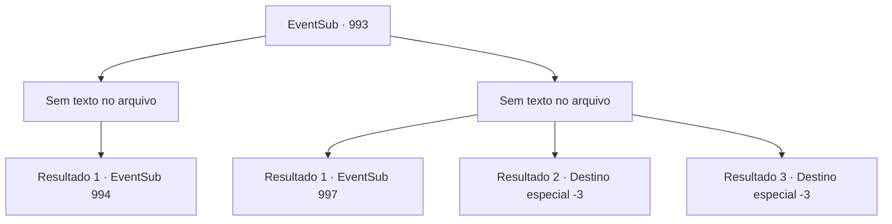

# Eventos secundários · 993

[Índice da tabela](index.md) · [Índice geral](../index.md)

ID: `pt:EventSub:993` · Fonte: `EventSub4` · Versão: 1.2.47.

Mapeamento estático dos arquivos; a disponibilidade e a execução dependem do estado da run.

## Texto do evento

*Sem texto no arquivo.*

## Dados de entrada

```json
{
  "id": 993,
  "grade": 1,
  "subEvent": "",
  "required": ""
}
```

## Mapa das escolhas



## Escolhas e resultados

### Escolha 1

*Sem texto no arquivo; o papel dessa opção depende da interface do jogo.*

Requisitos e outros campos da escolha:

```json
{
  "required": ""
}
```

#### Resultado 1.1

Você derrota todos os soldados sob o comando de Lukas. O homem com a espada larga avança para lidar com você. Ele avança em sua direção imediatamente.

Continuação registrada: [Evento 994](0994.md) na mesma tabela.

```json
{
  "required": "",
  "chance": "1",
  "nextEvent": 994,
  "type": 2,
  "reward": "6_4_185",
  "place": 1
}
```

### Escolha 2

*Sem texto no arquivo; o papel dessa opção depende da interface do jogo.*

Requisitos e outros campos da escolha:

```json
{
  "required": ""
}
```

#### Resultado 2.1

Você consegue se afastar deles e fugir. Você imediatamente se dirige ao castelo do Conde Ronan para entregar a carta.

Continuação registrada: [Evento 997](0997.md) na mesma tabela.

```json
{
  "required": "1_0_2|1_1_2",
  "chance": "1",
  "nextEvent": 997,
  "type": 2,
  "reward": "0_0_-1|0_1_-1"
}
```

#### Resultado 2.2

Os soldados de Lukas te dão uma boa surra, transformando você em um pedaço de carne sem vida.

Continuação registrada: [Destino especial `-3`](../destinos-especiais.md).

```json
{
  "required": "2_0_2",
  "chance": "1",
  "nextEvent": -3,
  "type": 2,
  "reward": "0_0_-1|0_1_-1"
}
```

#### Resultado 2.3

Os soldados de Lukas te dão uma boa surra, transformando você em um pedaço de carne sem vida.

Continuação registrada: [Destino especial `-3`](../destinos-especiais.md).

```json
{
  "required": "2_1_2",
  "chance": "1",
  "nextEvent": -3,
  "type": 2,
  "reward": "0_0_-1|0_1_-1"
}
```

## Referências que chegam a este evento

- [Evento 989 · escolha 2 · resultado 1](0989.md#escolha-2)
- [Evento 992 · escolha 2 · resultado 1](0992.md#escolha-2)
