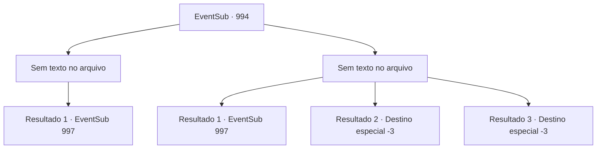

# Eventos secundários · 994

[Índice da tabela](index.md) · [Índice geral](../index.md)

ID: `pt:EventSub:994` · Fonte: `EventSub4` · Versão: 1.2.47.

Mapeamento estático dos arquivos; a disponibilidade e a execução dependem do estado da run.

## Texto do evento

*Sem texto no arquivo.*

## Dados de entrada

```json
{
  "id": 994,
  "grade": 1,
  "subEvent": "",
  "required": ""
}
```

## Mapa das escolhas



## Escolhas e resultados

### Escolha 1

*Sem texto no arquivo; o papel dessa opção depende da interface do jogo.*

Requisitos e outros campos da escolha:

```json
{
  "required": ""
}
```

#### Resultado 1.1

O homem com a espada larga não é páreo para você. Percebendo que está em uma situação difícil, ele tira uma pequena bolsa do bolso e a joga no chão. A bolsa explode, cobrindo a área com fumaça branca.  Você olha ao redor enquanto a fumaça se dissipa. Lukas e o espadachim não estão em lugar nenhum. Em um galho de árvore próximo, você nota um pedaço de tecido rasgado de uma túnica de sacerdote. Você se aproxima daquela árvore e olha para baixo do penhasco. Todo o caminho até o fundo do penhasco, você nota o cadáver de Lukas. Seu corpo está torcido de maneira antinatural, com sangue carmesim escorrendo das feridas. Você se vira e segue novamente em direção ao castelo do Conde Ronan.

Continuação registrada: [Evento 997](0997.md) na mesma tabela.

```json
{
  "required": "",
  "chance": "1",
  "nextEvent": 997,
  "type": 2,
  "reward": "5_798_1"
}
```

### Escolha 2

*Sem texto no arquivo; o papel dessa opção depende da interface do jogo.*

Requisitos e outros campos da escolha:

```json
{
  "required": ""
}
```

#### Resultado 2.1

Você não é páreo para o homem com a espada longa. Infelizmente, você se vira e foge. Você imediatamente se dirige ao castelo do Conde Ronan para entregar a carta.

Continuação registrada: [Evento 997](0997.md) na mesma tabela.

```json
{
  "required": "1_0_2|1_1_2",
  "chance": "1",
  "nextEvent": 997,
  "type": 2,
  "reward": "0_0_-1|0_1_-1"
}
```

#### Resultado 2.2

A pesada espada larga corta seu corpo ao meio. O homem levanta sua arma ensanguentada novamente, desta vez partindo seu crânio.

Continuação registrada: [Destino especial `-3`](../destinos-especiais.md).

```json
{
  "required": "2_0_2",
  "chance": "1",
  "nextEvent": -3,
  "type": 2,
  "reward": "0_0_-1|0_1_-1"
}
```

#### Resultado 2.3

A pesada espada larga corta seu corpo ao meio. O homem levanta sua arma ensanguentada novamente, desta vez partindo seu crânio.

Continuação registrada: [Destino especial `-3`](../destinos-especiais.md).

```json
{
  "required": "2_1_2",
  "chance": "1",
  "nextEvent": -3,
  "type": 2,
  "reward": "0_0_-1|0_1_-1"
}
```

## Referências que chegam a este evento

- [Evento 993 · escolha 1 · resultado 1](0993.md#escolha-1)
