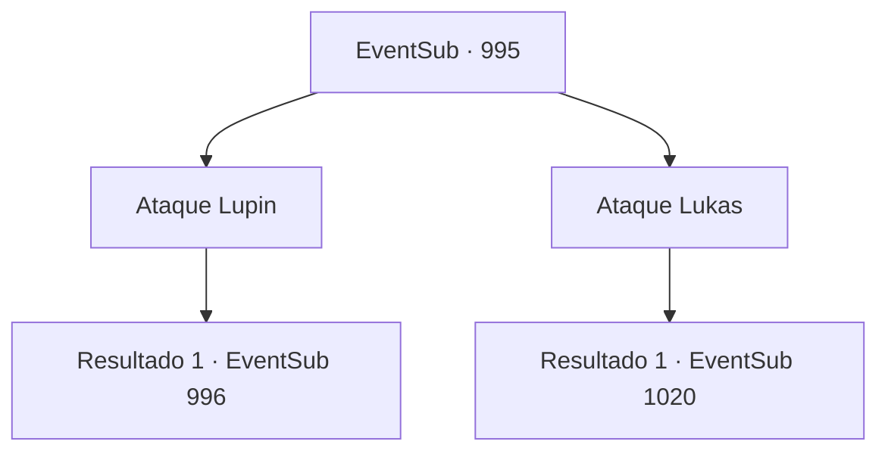

# Eventos secundários · 995

[Índice da tabela](index.md) · [Índice geral](../index.md)

ID: `pt:EventSub:995` · Fonte: `EventSub4` · Versão: 1.2.47.

Mapeamento estático dos arquivos; a disponibilidade e a execução dependem do estado da run.

## Texto do evento

*Sem texto no arquivo.*

## Dados de entrada

```json
{
  "id": 995,
  "grade": 1,
  "subEvent": "",
  "required": ""
}
```

## Mapa das escolhas



## Escolhas e resultados

### Escolha 1

Ataque Lupin

Requisitos e outros campos da escolha:

```json
{
  "required": ""
}
```

#### Resultado 1.1

Você se aproxima de Lupin e puxa sua arma. Percebendo que foi traído, ele prepara sua arma em resposta. 

 "Fui um tolo em confiar em você desde o início..."

 Então, ele avança em você como um lobo selvagem.

Continuação registrada: [Evento 996](0996.md) na mesma tabela.

```json
{
  "required": "",
  "chance": "1",
  "nextEvent": 996,
  "type": 2,
  "reward": "6_0_186",
  "place": 4
}
```

### Escolha 2

Ataque Lukas

Requisitos e outros campos da escolha:

```json
{
  "required": ""
}
```

#### Resultado 2.1

Em vez de ir atrás de Lupin, você se vira para pegar Lukas de surpresa. Mas Milorad consegue aparar seu ataque com sua espada larga. Vendo isso, Lupin se envolve preparando sua própria arma. 

 "Aha! Uma tática atemporal - você estava planejando atacá-los depois de ganhar a confiança deles! Entendi - vamos lidar com eles aqui e agora!"

 Você e Lupin unem forças e atacam Milorad.

Continuação registrada: [Evento 1020](1020.md) na mesma tabela.

```json
{
  "required": "",
  "chance": "1",
  "nextEvent": 1020,
  "type": 2,
  "reward": "6_2_185",
  "place": 4
}
```

## Referências que chegam a este evento

- [Evento 992 · escolha 1 · resultado 1](0992.md#escolha-1)
