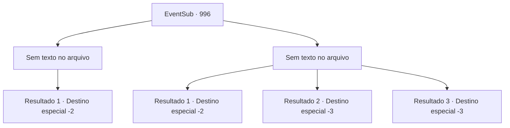

# Eventos secundários · 996

[Índice da tabela](index.md) · [Índice geral](../index.md)

ID: `pt:EventSub:996` · Fonte: `EventSub4` · Versão: 1.2.47.

Mapeamento estático dos arquivos; a disponibilidade e a execução dependem do estado da run.

## Texto do evento

*Sem texto no arquivo.*

## Dados de entrada

```json
{
  "id": 996,
  "grade": 1,
  "subEvent": "",
  "required": ""
}
```

## Mapa das escolhas



## Escolhas e resultados

### Escolha 1

*Sem texto no arquivo; o papel dessa opção depende da interface do jogo.*

Requisitos e outros campos da escolha:

```json
{
  "required": ""
}
```

#### Resultado 1.1

Você acaba com a vida de Lupin. Seu rosto ainda furioso de raiva, o nobre cavaleiro desaba no chão. Lukas prossegue para entrar no prédio, procurando o lugar por Edward. Quando finalmente é encontrado, o jovem tenta fugir, mas é capturado por Milorad. 

 "Adeus."

 Sem hesitação, Milorad acaba com a vida de Edward. Em seguida, ele enfia seu corpo em um saco. 

 "Vamos indo, então. Não esqueceremos sua ajuda."


Continuação registrada: [Destino especial `-2`](../destinos-especiais.md).

```json
{
  "required": "",
  "chance": "1",
  "nextEvent": -2,
  "type": 2,
  "reward": "12_12_-1|14_12_0"
}
```

### Escolha 2

*Sem texto no arquivo; o papel dessa opção depende da interface do jogo.*

Requisitos e outros campos da escolha:

```json
{
  "required": ""
}
```

#### Resultado 2.1

Com perícia em esgrima, Lupin derrota você. Ele alcança seu pescoço sem hesitação, mas Milorad intervém e salva você. Ofegante, Lupin continua sua luta, desta vez com Milorad. Mas ele já está exausto - Milorad o derrota rapidamente. Infelizmente, a espada larga triunfa. Com o rosto ainda furioso de raiva, o nobre cavaleiro desaba no chão. Lukas prossegue para entrar no prédio, procurando por Edward. Quando finalmente é encontrado, o jovem tenta fugir, mas é capturado por Milorad. 

 "Adeus."

 Sem hesitação, Milorad tira a vida de Edward. Em seguida, ele coloca o corpo em um saco. 

 "Vamos indo, então. Não esqueceremos sua ajuda."


Continuação registrada: [Destino especial `-2`](../destinos-especiais.md).

```json
{
  "required": "1_0_2|1_1_2",
  "chance": "1",
  "nextEvent": -2,
  "type": 2,
  "reward": "0_0_-1|0_1_-1|12_12_-1|14_12_0"
}
```

#### Resultado 2.2

A espada de Lupin perfura seu coração. Sangue espirra da sua boca. Você cai no chão sem forças. 

 "Que verme inútil."

 Lukas estalando a língua é a última coisa que você ouve antes de perder a consciência.

Continuação registrada: [Destino especial `-3`](../destinos-especiais.md).

```json
{
  "required": "2_0_2",
  "chance": "1",
  "nextEvent": -3,
  "type": 2,
  "reward": "0_0_-1|0_1_-1"
}
```

#### Resultado 2.3

A espada de Lupin perfura seu coração. Sangue espirra da sua boca. Você cai no chão sem forças. 

 "Que verme inútil."

 Lukas estalando a língua é a última coisa que você ouve antes de perder a consciência.

Continuação registrada: [Destino especial `-3`](../destinos-especiais.md).

```json
{
  "required": "2_1_2",
  "chance": "1",
  "nextEvent": -3,
  "type": 2,
  "reward": "0_0_-1|0_1_-1"
}
```

## Referências que chegam a este evento

- [Evento 995 · escolha 1 · resultado 1](0995.md#escolha-1)
