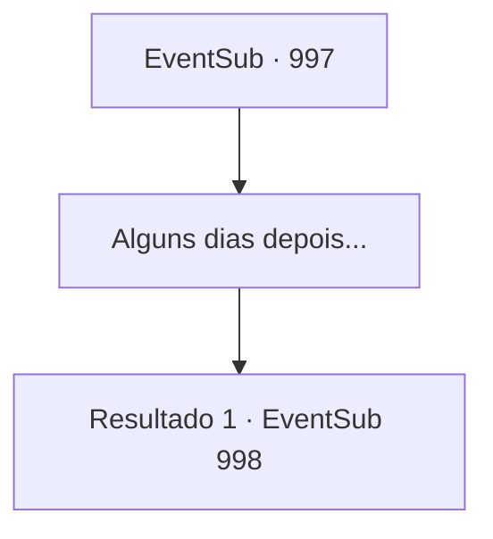

# Eventos secundários · 997

[Índice da tabela](index.md) · [Índice geral](../index.md)

ID: `pt:EventSub:997` · Fonte: `EventSub4` · Versão: 1.2.47.

Mapeamento estático dos arquivos; a disponibilidade e a execução dependem do estado da run.

## Texto do evento

*Sem texto no arquivo.*

## Dados de entrada

```json
{
  "id": 997,
  "grade": 1,
  "subEvent": "",
  "required": ""
}
```

## Mapa das escolhas



## Escolhas e resultados

### Escolha 1

Alguns dias depois...

Requisitos e outros campos da escolha:

```json
{
  "required": ""
}
```

#### Resultado 1.1

|drawing_Rouent| Alguns dias depois, você finalmente chega a Rouent.  No topo da colina está o castelo do Conde - um ponto de vista com uma bela vista de toda Rouent.  Ao se aproximar dos portões do castelo, os guardas pedem que você declare seu propósito.  Você mostra a eles a carta de Lupin.  Um dos guardas ordena que você o siga, escoltando-o até a sala de audiência. 

 A porta pesada se abre. Você entra no salão espaçoso.  Paredes de pedra fria cobrem a área, com um lustre de ferro pendurado no teto, emitindo uma luz fraca.  No final do salão há uma fundação elevada, sobre a qual estão três cadeiras luxuosas.  Sentado na cadeira central está ninguém menos que o próprio Conde Ronan.  Nas duas cadeiras ao redor do Conde devem estar suas esposas.  Uma parece ter a mesma idade do Conde, com cabelos branco-prateados e olhos vermelhos como carmim que lembram Edward.  A outra, com cabelos loiros e encaracolados, está, a julgar pelo tamanho de sua barriga, grávida.  Ela parece muito mais jovem que o Conde.  O olhar do Conde pousa em você.  

 "Então - ouvi dizer que você tem algo para mim?"


Continuação registrada: [Evento 998](0998.md) na mesma tabela.

```json
{
  "required": "",
  "chance": "1",
  "nextEvent": 998,
  "type": 2,
  "reward": ""
}
```

## Referências que chegam a este evento

- [Evento 993 · escolha 2 · resultado 1](0993.md#escolha-2)
- [Evento 994 · escolha 1 · resultado 1](0994.md#escolha-1)
- [Evento 994 · escolha 2 · resultado 1](0994.md#escolha-2)
