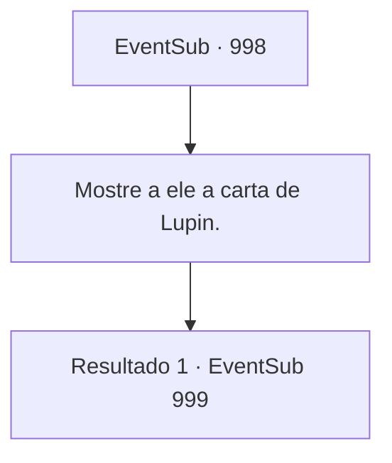

# Eventos secundários · 998

[Índice da tabela](index.md) · [Índice geral](../index.md)

ID: `pt:EventSub:998` · Fonte: `EventSub4` · Versão: 1.2.47.

Mapeamento estático dos arquivos; a disponibilidade e a execução dependem do estado da run.

## Texto do evento

*Sem texto no arquivo.*

## Dados de entrada

```json
{
  "id": 998,
  "grade": 1,
  "subEvent": "",
  "required": ""
}
```

## Mapa das escolhas



## Escolhas e resultados

### Escolha 1

Mostre a ele a carta de Lupin.

Requisitos e outros campos da escolha:

```json
{
  "required": ""
}
```

#### Resultado 1.1

O Conde Ronan lê a carta com uma expressão preocupada. 

 "Lukas estava escondido nas Catacumbas o tempo todo...! Bem, pelo menos há uma boa notícia. Lupin deve estar cuidando bem de Edward."

 O Conde leva a mão à testa, depois dá ordens aos seus cavaleiros. 

 "Então? Preparem-se. Vão e tragam de volta Lupin e Edward. Sãos e salvos."

 Em seguida, ele se volta para você e acrescenta. 

 "Quanto a você... Pode descansar no castelo por enquanto."

 Um dos servos o acompanha até os aposentos dos hóspedes. Enquanto isso, os cavaleiros do Conde já partiram para procurar Edward. 

 Algumas horas depois, você ouve uma comoção ao redor do castelo. Você tenta abrir a porta e sair, mas algo está bloqueando-a do lado de fora.

Continuação registrada: [Evento 999](0999.md) na mesma tabela.

```json
{
  "required": "",
  "chance": "1",
  "nextEvent": 999,
  "type": 2,
  "reward": ""
}
```

## Referências que chegam a este evento

- [Evento 997 · escolha 1 · resultado 1](0997.md#escolha-1)
