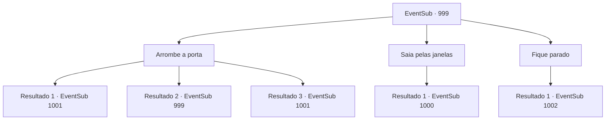

# Eventos secundários · 999

[Índice da tabela](index.md) · [Índice geral](../index.md)

ID: `pt:EventSub:999` · Fonte: `EventSub4` · Versão: 1.2.47.

Mapeamento estático dos arquivos; a disponibilidade e a execução dependem do estado da run.

## Texto do evento

*Sem texto no arquivo.*

## Dados de entrada

```json
{
  "id": 999,
  "grade": 1,
  "subEvent": "",
  "required": ""
}
```

## Mapa das escolhas



## Escolhas e resultados

### Escolha 1

Arrombe a porta

Requisitos e outros campos da escolha:

```json
{
  "required": "5_799_0"
}
```

#### Resultado 1.1

Você chuta a porta e sai pelo corredor. Aqui e ali, você percebe que os soldados do Conde estão lutando entre si. Em meio ao pânico, você nota um rosto familiar entrando no castelo - o homem que o atacou da última vez. Ele grita ordens furiosamente para seus soldados. 

 "RÁPIDO! ENCONTREM O CONDE!"


Continuação registrada: [Evento 1001](1001.md) na mesma tabela.

```json
{
  "required": "21_60_2",
  "chance": "1|0_5_1",
  "nextEvent": 1001,
  "type": 0,
  "reward": "5_799_1"
}
```

#### Resultado 1.2

Você tenta chutar a porta, mas ela é mais forte do que você parece.

Continuação registrada: [Evento 999](0999.md) na mesma tabela.

```json
{
  "required": "21_60_2",
  "chance": "16",
  "nextEvent": 999,
  "type": 1,
  "reward": "5_799_2"
}
```

#### Resultado 1.3

Você chuta a porta e sai pelo corredor. Aqui e ali, você percebe que os soldados do Conde estão lutando entre si. Em meio ao pânico, você nota um rosto familiar entrando no castelo - o homem que o atacou da última vez. Ele grita ordens furiosamente para seus soldados. 

 "RÁPIDO! ENCONTREM O CONDE!"


Continuação registrada: [Evento 1001](1001.md) na mesma tabela.

```json
{
  "required": "20_60_2",
  "chance": "1",
  "nextEvent": 1001,
  "type": 2,
  "reward": ""
}
```

### Escolha 2

Saia pelas janelas

Requisitos e outros campos da escolha:

```json
{
  "required": ""
}
```

#### Resultado 2.1

Você quebra as janelas, pula pela varanda e olha para baixo. Aqui e ali, você percebe que os soldados do Conde estão lutando entre si. Em meio ao pânico, você nota um rosto familiar entrando no castelo - o homem que o atacou da última vez. Ele grita ordens furiosamente para seus soldados. 

 "RÁPIDO! ENCONTREM O CONDE!"


Continuação registrada: [Evento 1000](1000.md) na mesma tabela.

```json
{
  "required": "",
  "chance": "1",
  "nextEvent": 1000,
  "type": 2,
  "reward": ""
}
```

### Escolha 3

Fique parado

Requisitos e outros campos da escolha:

```json
{
  "required": ""
}
```

#### Resultado 3.1

Você decide esperar. Mas, à medida que o tempo passa, a comoção fica cada vez mais alta. Logo, com um estrondo alto, a porta do quarto de hóspedes é derrubada, e um grupo de soldados armados entra na sala. Entre eles está um rosto familiar - o homem com a espada larga. Ele te nota e sorri com desdém. Com indiferença, ele levanta a mão para sinalizar seus soldados. 

 "Lidem com esse aí."

 Seguindo sua ordem, os soldados começam a te cercar com suas armas em punho.

Continuação registrada: [Evento 1002](1002.md) na mesma tabela.

```json
{
  "required": "",
  "chance": "1",
  "nextEvent": 1002,
  "type": 2,
  "reward": "6_0_136",
  "place": 10
}
```

## Referências que chegam a este evento

- [Evento 998 · escolha 1 · resultado 1](0998.md#escolha-1)
- [Evento 999 · escolha 1 · resultado 2](0999.md#escolha-1)
