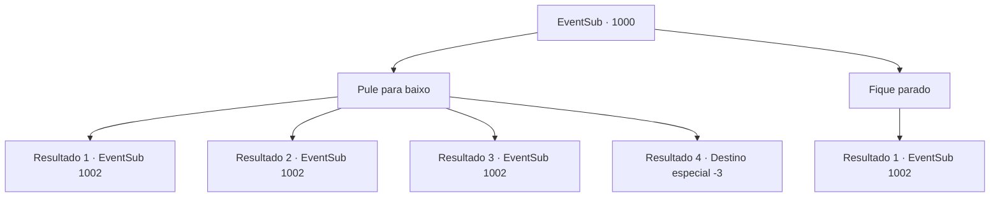

# Eventos secundários · 1000

[Índice da tabela](index.md) · [Índice geral](../index.md)

ID: `pt:EventSub:1000` · Fonte: `EventSub4` · Versão: 1.2.47.

Mapeamento estático dos arquivos; a disponibilidade e a execução dependem do estado da run.

## Texto do evento

*Sem texto no arquivo.*

## Dados de entrada

```json
{
  "id": 1000,
  "grade": 1,
  "subEvent": "",
  "required": ""
}
```

## Mapa das escolhas



## Escolhas e resultados

### Escolha 1

Pule para baixo

Requisitos e outros campos da escolha:

```json
{
  "required": ""
}
```

#### Resultado 1.1

Você salta, fazendo uma entrada repentina do nada. Os soldados ficam visivelmente surpresos. 

 "Q- QUE DIABOS!"

 Você imediatamente começa a atacar os soldados. O homem com a espada larga te ignora e corre para dentro do castelo.

Continuação registrada: [Evento 1002](1002.md) na mesma tabela.

```json
{
  "required": "-1|20_0_1|20_10_1",
  "chance": "1",
  "nextEvent": 1002,
  "type": 2,
  "reward": "6_2_136",
  "place": 10
}
```

#### Resultado 1.2

Você salta, fazendo uma entrada repentina do nada. Os soldados ficam visivelmente surpresos. 

 "Q- QUE DIABOS!"

 Você imediatamente começa a atacar os soldados. O homem com a espada larga te ignora e corre para dentro do castelo.

Continuação registrada: [Evento 1002](1002.md) na mesma tabela.

```json
{
  "required": "21_0_1|21_10_1",
  "chance": "1|0_13_1",
  "nextEvent": 1002,
  "type": 0,
  "reward": "6_2_136",
  "place": 10
}
```

#### Resultado 1.3

Você salta, fazendo uma entrada repentina do nada. A queda foi mais alta do que você esperava - você sente uma dor aguda no tornozelo. Os soldados estão visivelmente surpresos. 

 "O- QUE DIABOS!"

 Você imediatamente começa a atacar os soldados. O homem com a espada larga te ignora e corre para dentro do castelo.

Continuação registrada: [Evento 1002](1002.md) na mesma tabela.

```json
{
  "required": "1_0_2|21_0_1|21_10_1",
  "chance": "20",
  "nextEvent": 1002,
  "type": 1,
  "reward": "0_0_-1|6_2_136",
  "place": 10
}
```

#### Resultado 1.4

Você pula, fazendo uma entrada repentina do nada.   A queda foi mais alta do que você esperava - você cai de costas.   Os soldados estão visivelmente surpresos.   

 "Q- QUE DIABOS!"

   Isso é a última coisa que você ouve antes de perder a consciência.

Continuação registrada: [Destino especial `-3`](../destinos-especiais.md).

```json
{
  "required": "2_0_2|21_0_1|21_10_1",
  "chance": "20",
  "nextEvent": -3,
  "type": 1,
  "reward": "0_0_-1"
}
```

### Escolha 2

Fique parado

Requisitos e outros campos da escolha:

```json
{
  "required": ""
}
```

#### Resultado 2.1

Logo, com um estrondo alto, a porta do quarto de hóspedes é arrombada, e um grupo de soldados armados entra na sala. Entre eles está um rosto familiar - o homem com a espada larga. Ele te nota e sorri com desdém. Com indiferença, ele levanta a mão para sinalizar seus soldados. 

 "Cuidem desse aí."

 Seguindo sua ordem, os soldados começam a te cercar com suas armas em punho.

Continuação registrada: [Evento 1002](1002.md) na mesma tabela.

```json
{
  "required": "",
  "chance": "1",
  "nextEvent": 1002,
  "type": 2,
  "reward": "6_0_136",
  "place": 10
}
```

## Referências que chegam a este evento

- [Evento 999 · escolha 2 · resultado 1](0999.md#escolha-2)
