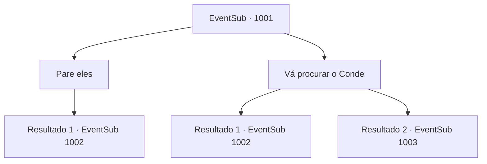

# Eventos secundários · 1001

[Índice da tabela](index.md) · [Índice geral](../index.md)

ID: `pt:EventSub:1001` · Fonte: `EventSub4` · Versão: 1.2.47.

Mapeamento estático dos arquivos; a disponibilidade e a execução dependem do estado da run.

## Texto do evento

*Sem texto no arquivo.*

## Dados de entrada

```json
{
  "id": 1001,
  "grade": 1,
  "subEvent": "",
  "required": ""
}
```

## Mapa das escolhas



## Escolhas e resultados

### Escolha 1

Pare eles

Requisitos e outros campos da escolha:

```json
{
  "required": ""
}
```

#### Resultado 1.1

Você avança, bloqueando o caminho deles.   O homem com a espada larga te nota e sorri com desdém.   Com indiferença, ele levanta a mão para sinalizar seus soldados.   

 "Acabem com esse aí."

   Seguindo sua ordem, os soldados começam a te cercar com suas armas em punho.

Continuação registrada: [Evento 1002](1002.md) na mesma tabela.

```json
{
  "required": "",
  "chance": "1",
  "nextEvent": 1002,
  "type": 2,
  "reward": "6_0_136",
  "place": 10
}
```

### Escolha 2

Vá procurar o Conde

Requisitos e outros campos da escolha:

```json
{
  "required": ""
}
```

#### Resultado 2.1

Em meio ao pânico, você corre pelo castelo para encontrar o Conde. Mas durante sua busca, você se depara com Lukas. 

 "Matem aquele aventureiro!"

 Lukas grita, enquanto soldados armados sob seu comando começam a avançar em sua direção.

Continuação registrada: [Evento 1002](1002.md) na mesma tabela.

```json
{
  "required": "18_798_1",
  "chance": "1",
  "nextEvent": 1002,
  "type": 2,
  "reward": "6_0_136",
  "place": 10
}
```

#### Resultado 2.2

Em meio ao pânico, você corre pelo castelo para encontrar o Conde. Você finalmente encontra o Conde e suas esposas indo para a biblioteca do castelo, escoltados por um cavaleiro e alguns soldados.

Continuação registrada: [Evento 1003](1003.md) na mesma tabela.

```json
{
  "required": "5_798_1",
  "chance": "1",
  "nextEvent": 1003,
  "type": 2,
  "reward": ""
}
```

## Referências que chegam a este evento

- [Evento 999 · escolha 1 · resultado 1](0999.md#escolha-1)
- [Evento 999 · escolha 1 · resultado 3](0999.md#escolha-1)
