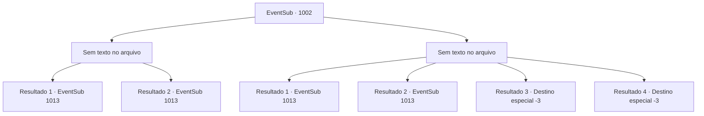

# Eventos secundários · 1002

[Índice da tabela](index.md) · [Índice geral](../index.md)

ID: `pt:EventSub:1002` · Fonte: `EventSub4` · Versão: 1.2.47.

Mapeamento estático dos arquivos; a disponibilidade e a execução dependem do estado da run.

## Texto do evento

*Sem texto no arquivo.*

## Dados de entrada

```json
{
  "id": 1002,
  "grade": 1,
  "subEvent": "",
  "required": ""
}
```

## Mapa das escolhas



## Escolhas e resultados

### Escolha 1

*Sem texto no arquivo; o papel dessa opção depende da interface do jogo.*

Requisitos e outros campos da escolha:

```json
{
  "required": ""
}
```

#### Resultado 1.1

Você derrota os soldados, indo imediatamente atrás do homem com a espada larga. Localizá-lo não é difícil, graças ao tamanho de sua arma e a Lukas sempre o acompanhando. Eles estão indo para o porão, escoltados por alguns soldados.

Continuação registrada: [Evento 1013](1013.md) na mesma tabela.

```json
{
  "required": "18_798_1",
  "chance": "1",
  "nextEvent": 1013,
  "type": 2,
  "reward": ""
}
```

#### Resultado 1.2

Você derrota os soldados, indo imediatamente atrás do homem com a espada larga. Localizá-lo não é difícil, graças ao tamanho de sua arma. Ele está indo para o porão, escoltado por alguns soldados.

Continuação registrada: [Evento 1013](1013.md) na mesma tabela.

```json
{
  "required": "5_798_1",
  "chance": "1",
  "nextEvent": 1013,
  "type": 2,
  "reward": ""
}
```

### Escolha 2

*Sem texto no arquivo; o papel dessa opção depende da interface do jogo.*

Requisitos e outros campos da escolha:

```json
{
  "required": ""
}
```

#### Resultado 2.1

Você é derrotado pelos soldados e jogado ao chão. Mas você consegue sobreviver - soldados sob o comando do Conde se juntaram à batalha. Você aproveita a oportunidade e foge para um lugar seguro. Então, você nota o homem com a espada larga e Lukas indo para o porão, escoltados por alguns soldados.

Continuação registrada: [Evento 1013](1013.md) na mesma tabela.

```json
{
  "required": "1_0_2|1_1_2|18_798_1",
  "chance": "1",
  "nextEvent": 1013,
  "type": 2,
  "reward": "0_0_-1|0_1_-1"
}
```

#### Resultado 2.2

Você é derrotado pelos soldados e jogado ao chão. Mas você consegue sobreviver - soldados sob o comando do Conde se juntaram à batalha. Você aproveita a oportunidade e foge para um lugar seguro. Então, você nota o homem com a espada larga e Lukas indo para o porão, escoltados por alguns soldados.

Continuação registrada: [Evento 1013](1013.md) na mesma tabela.

```json
{
  "required": "1_0_2|1_1_2|5_798_1",
  "chance": "1",
  "nextEvent": 1013,
  "type": 2,
  "reward": "0_0_-1|0_1_-1"
}
```

#### Resultado 2.3

Você é derrotado pelos soldados e jogado ao chão. Ninguém vem em seu auxílio. Os soldados estão ocupados demais lutando para perceber que o pisotearam até a morte.

Continuação registrada: [Destino especial `-3`](../destinos-especiais.md).

```json
{
  "required": "2_0_2",
  "chance": "1",
  "nextEvent": -3,
  "type": 2,
  "reward": "0_0_-1|0_1_-1"
}
```

#### Resultado 2.4

Você é derrotado pelos soldados e jogado ao chão. Ninguém vem em seu auxílio. Os soldados estão ocupados demais lutando para perceber que o pisotearam até a morte.

Continuação registrada: [Destino especial `-3`](../destinos-especiais.md).

```json
{
  "required": "2_1_2",
  "chance": "1",
  "nextEvent": -3,
  "type": 2,
  "reward": "0_0_-1|0_1_-1"
}
```

## Referências que chegam a este evento

- [Evento 999 · escolha 3 · resultado 1](0999.md#escolha-3)
- [Evento 1000 · escolha 1 · resultado 1](1000.md#escolha-1)
- [Evento 1000 · escolha 1 · resultado 2](1000.md#escolha-1)
- [Evento 1000 · escolha 1 · resultado 3](1000.md#escolha-1)
- [Evento 1000 · escolha 2 · resultado 1](1000.md#escolha-2)
- [Evento 1001 · escolha 1 · resultado 1](1001.md#escolha-1)
- [Evento 1001 · escolha 2 · resultado 1](1001.md#escolha-2)
