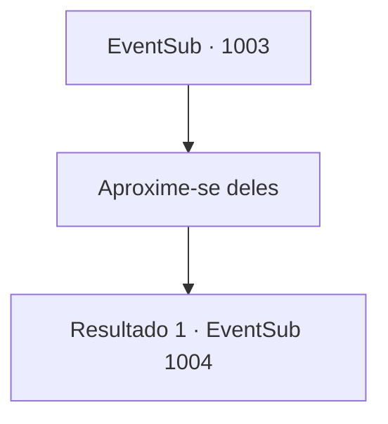

# Eventos secundários · 1003

[Índice da tabela](index.md) · [Índice geral](../index.md)

ID: `pt:EventSub:1003` · Fonte: `EventSub4` · Versão: 1.2.47.

Mapeamento estático dos arquivos; a disponibilidade e a execução dependem do estado da run.

## Texto do evento

*Sem texto no arquivo.*

## Dados de entrada

```json
{
  "id": 1003,
  "grade": 1,
  "subEvent": "",
  "required": ""
}
```

## Mapa das escolhas



## Escolhas e resultados

### Escolha 1

Aproxime-se deles

Requisitos e outros campos da escolha:

```json
{
  "required": ""
}
```

#### Resultado 1.1

Você se aproxima deles, oferecendo-se para ajudar. Hazel percebe você e grita com raiva. 

 "VOCÊ! Toda essa bagunça - aconteceu logo após a sua chegada! Apenas nos diga como podemos confiar em você em uma situação como esta?!"

 As palavras dela parecem ter gerado um conflito na mente do Conde.

Continuação registrada: [Evento 1004](1004.md) na mesma tabela.

```json
{
  "required": "",
  "chance": "1",
  "nextEvent": 1004,
  "type": 2,
  "reward": ""
}
```

## Referências que chegam a este evento

- [Evento 1001 · escolha 2 · resultado 2](1001.md#escolha-2)
