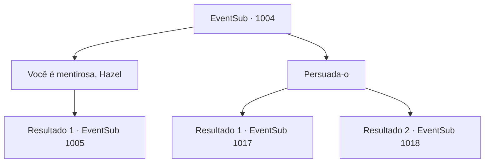

# Eventos secundários · 1004

[Índice da tabela](index.md) · [Índice geral](../index.md)

ID: `pt:EventSub:1004` · Fonte: `EventSub4` · Versão: 1.2.47.

Mapeamento estático dos arquivos; a disponibilidade e a execução dependem do estado da run.

## Texto do evento

*Sem texto no arquivo.*

## Dados de entrada

```json
{
  "id": 1004,
  "grade": 1,
  "subEvent": "",
  "required": ""
}
```

## Mapa das escolhas



## Escolhas e resultados

### Escolha 1

Você é mentirosa, Hazel

Requisitos e outros campos da escolha:

```json
{
  "required": "8_365_1"
}
```

#### Resultado 1.1

Você tira uma carta do bolso e a entrega ao Conde Ronan, dizendo que Hazel é a que não pode ser confiada. Os olhos do Conde se arregalam ao ler a carta. 

 "I- isto é... HAZEL...! COMO PÔDE?!"

 Seu rosto fica vermelho de raiva. Ele joga a carta no rosto de Hazel, depois bate em uma mesa próxima, jogando documentos de papel no ar. Mas Hazel ainda não admitiu sua culpa. 

 "N- NÃO! Não vê, meu amor, que esta carta é FALSA?! Você está realmente acreditando nas palavras de um estranho em vez das minhas!?"

 Mas o Conde está decidido. 

 "Vou lidar com esta rebelião primeiro e depois volto para você."

 Ele empurra Hazel para longe, chamando seu nome friamente. 

 "Hazel Radichevski."

 Hazel franze a testa em resposta. O Conde então se volta para você. 

 "Devo pedir sua ajuda também."

 O Conde aperta o punho em sua espada, então a balança contra os soldados sem hesitação.

Continuação registrada: [Evento 1005](1005.md) na mesma tabela.

```json
{
  "required": "",
  "chance": "1",
  "nextEvent": 1005,
  "type": 2,
  "reward": "6_0_136|4_365_1|5_800_1",
  "place": 10
}
```

### Escolha 2

Persuada-o

Requisitos e outros campos da escolha:

```json
{
  "required": ""
}
```

#### Resultado 2.1

Você apela ao Conde Ronan que realmente deseja ajudar. Ele responde que está disposto a confiar em você. 

 "Certo, aventureiro. Eu acredito em você. Então, como você lidaria com esta situação?"

 Hazel diz que a primeira prioridade deve ser evacuar do castelo. Irema, por outro lado, afirma que lidar com a rebelião deve vir primeiro.

Continuação registrada: [Evento 1017](1017.md) na mesma tabela.

```json
{
  "required": "",
  "chance": "1|0_12_1",
  "nextEvent": 1017,
  "type": 0,
  "reward": ""
}
```

#### Resultado 2.2

Você tenta convencer o Conde. Mas ele permanece inflexível, balançando a cabeça. 

 "Chega, chega... Minha cabeça já está uma bagunça. Preciso chegar a um lugar seguro primeiro. Não me faça mais perguntas. E não me siga."

 Eles vão para a biblioteca do castelo, deixando você para trás.

Continuação registrada: [Evento 1018](1018.md) na mesma tabela.

```json
{
  "required": "",
  "chance": "26",
  "nextEvent": 1018,
  "type": 1,
  "reward": ""
}
```

## Referências que chegam a este evento

- [Evento 1003 · escolha 1 · resultado 1](1003.md#escolha-1)
