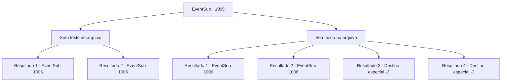

# Eventos secundários · 1005

[Índice da tabela](index.md) · [Índice geral](../index.md)

ID: `pt:EventSub:1005` · Fonte: `EventSub4` · Versão: 1.2.47.

Mapeamento estático dos arquivos; a disponibilidade e a execução dependem do estado da run.

## Texto do evento

*Sem texto no arquivo.*

## Dados de entrada

```json
{
  "id": 1005,
  "grade": 1,
  "subEvent": "",
  "required": ""
}
```

## Mapa das escolhas



## Escolhas e resultados

### Escolha 1

*Sem texto no arquivo; o papel dessa opção depende da interface do jogo.*

Requisitos e outros campos da escolha:

```json
{
  "required": ""
}
```

#### Resultado 1.1

Você ajuda o Conde Ronan a lutar contra os soldados rebeldes. Então, uma das estantes na biblioteca começa a se mover, revelando uma passagem secreta. Lukas e o homem com a espada larga saem do caminho oculto, atacando imediatamente o Conde Ronan. O Conde tenta desviar do ataque, mas não é rápido o suficiente. Ele cambaleia para trás, sangrando. 

 "M- MEU AMOR!"

 Irema fica pálida de medo. Depois de verificar os rostos dos atacantes, Ronan começa a tremer de ressentimento. 

 "Lukas...!! Você ousa tramar algo tão nefasto como um BISPO?! Que os Deuses te levem."

 Lukas simplesmente dá de ombros em resposta. 

 "Bem... Vou me certificar de enviar minhas orações a eles, então."

 Ele dá um sinal, inclinando a cabeça. 

 "Milorad? Sua vez."

 Assim que ele termina, o homem com a espada larga se prepara para lutar.

Continuação registrada: [Evento 1006](1006.md) na mesma tabela.

```json
{
  "required": "18_798_1",
  "chance": "1",
  "nextEvent": 1006,
  "type": 2,
  "reward": "6_0_185",
  "place": 10
}
```

#### Resultado 1.2

Você ajuda o Conde Ronan a lutar contra os soldados rebeldes. Então, uma das estantes na biblioteca começa a se mover, revelando uma passagem secreta. O homem com a espada larga sai do caminho oculto, atacando imediatamente o Conde Ronan. O Conde tenta desviar do ataque, mas não é rápido o suficiente. Ele cambaleia para trás, sangrando. 

 "M- MEU AMOR!"

 Irema fica pálida de medo. O agressor silenciosamente levanta sua espada larga em sua direção.

Continuação registrada: [Evento 1006](1006.md) na mesma tabela.

```json
{
  "required": "5_798_1",
  "chance": "1",
  "nextEvent": 1006,
  "type": 2,
  "reward": "6_2_185",
  "place": 10
}
```

### Escolha 2

*Sem texto no arquivo; o papel dessa opção depende da interface do jogo.*

Requisitos e outros campos da escolha:

```json
{
  "required": ""
}
```

#### Resultado 2.1

Você ajuda o Conde Ronan a lutar contra os soldados rebeldes. Mas você sozinho não é capaz o suficiente. As armas dos soldados cortam e ferem você. Logo, você está sangrando por todo o corpo. Então, uma das estantes na biblioteca começa a se mover, revelando uma passagem secreta. Lukas e o homem com a espada larga saem do caminho escondido, atacando imediatamente o Conde Ronan. O Conde tenta desviar do ataque, mas não é rápido o suficiente. Ele cambaleia para trás, sangrando. 

 "M- MEU AMOR!"

 Irema fica pálida de medo. Depois de verificar os rostos dos atacantes, Ronan começa a tremer de ressentimento. 

 "Lukas...!! Você se atreve a tramar algo tão nefasto como um BISPO?! Que os Deuses te levem."

 Lukas simplesmente dá de ombros em resposta. 

 "Bem... Vou me certificar de enviar minhas orações a eles, então."

 Ele dá um sinal, inclinando a cabeça. 

 "Milorad? Sua vez."

 Assim que ele termina, o homem com a espada larga se prepara para lutar.

Continuação registrada: [Evento 1006](1006.md) na mesma tabela.

```json
{
  "required": "1_0_2|1_1_2|18_798_1",
  "chance": "1",
  "nextEvent": 1006,
  "type": 2,
  "reward": "0_0_-1|0_1_-1|6_0_185",
  "place": 10
}
```

#### Resultado 2.2

Você ajuda o Conde Ronan a lutar contra os soldados rebeldes. Mas você sozinho não é capaz o suficiente. As armas dos soldados cortam e ferem você. Logo, você está sangrando por todo o corpo. Então, uma das estantes na biblioteca começa a se mover, revelando uma passagem secreta. Lukas e o homem com a espada larga saem do caminho escondido, atacando imediatamente o Conde Ronan. O Conde tenta desviar do ataque, mas não é rápido o suficiente. Ele cambaleia para trás, sangrando. 

 "M- MEU AMOR!"

 Irema fica pálida de medo. O agressor levanta silenciosamente sua espada larga em sua direção.

Continuação registrada: [Evento 1006](1006.md) na mesma tabela.

```json
{
  "required": "1_0_2|1_1_2|5_798_1",
  "chance": "1",
  "nextEvent": 1006,
  "type": 2,
  "reward": "0_0_-1|0_1_-1|6_2_185",
  "place": 10
}
```

#### Resultado 2.3

Cortado e ferido pelas armas dos soldados, você perde a consciência.

Continuação registrada: [Destino especial `-3`](../destinos-especiais.md).

```json
{
  "required": "2_0_2",
  "chance": "1",
  "nextEvent": -3,
  "type": 2,
  "reward": "0_0_-1|0_1_-1"
}
```

#### Resultado 2.4

Cortado e ferido pelas armas dos soldados, você perde a consciência.

Continuação registrada: [Destino especial `-3`](../destinos-especiais.md).

```json
{
  "required": "2_1_2",
  "chance": "1",
  "nextEvent": -3,
  "type": 2,
  "reward": "0_0_-1|0_1_-1"
}
```

## Referências que chegam a este evento

- [Evento 1004 · escolha 1 · resultado 1](1004.md#escolha-1)
- [Evento 1017 · escolha 1 · resultado 1](1017.md#escolha-1)
