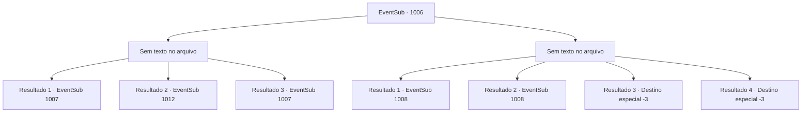

# Eventos secundários · 1006

[Índice da tabela](index.md) · [Índice geral](../index.md)

ID: `pt:EventSub:1006` · Fonte: `EventSub4` · Versão: 1.2.47.

Mapeamento estático dos arquivos; a disponibilidade e a execução dependem do estado da run.

## Texto do evento

*Sem texto no arquivo.*

## Dados de entrada

```json
{
  "id": 1006,
  "grade": 1,
  "subEvent": "",
  "required": ""
}
```

## Mapa das escolhas



## Escolhas e resultados

### Escolha 1

*Sem texto no arquivo; o papel dessa opção depende da interface do jogo.*

Requisitos e outros campos da escolha:

```json
{
  "required": ""
}
```

#### Resultado 1.1

Você consegue derrotar Milorad. Enquanto isso, o Conde Ronan também lidou com Lukas. Com os líderes capturados, a luta favorece o Conde. Os soldados que se aliaram à rebelião começam a abandonar suas armas, rendendo-se. A rebelião foi suprimida. 

 "Joguem todos nas masmorras do castelo!"

 O Conde ordena que seus soldados prendam os líderes e participantes da rebelião. Ele lava o suor do rosto e solta um longo suspiro, como se o cansaço e o estresse mental finalmente tivessem cobrado seu preço. O Conde desaba no chão. 

 "*suspiro*... Estou cansado. Por favor, espere um segundo."

 Irema ajuda o Conde a se levantar. Então, o Conde volta para o seu quarto. O mordomo pessoal de Ronan se dirige a você. 

 "O Conde deve estar em estado de choque. Por favor, dê-lhe um minuto."


Continuação registrada: [Evento 1007](1007.md) na mesma tabela.

```json
{
  "required": "18_798_1",
  "chance": "1",
  "nextEvent": 1007,
  "type": 2,
  "reward": ""
}
```

#### Resultado 1.2

Você e o Conde unem forças, derrubando Milorad. Com o líder da rebelião capturado, a luta favorece o Conde. Os soldados que se aliaram à rebelião começam a abandonar suas armas, rendendo-se. A rebelião foi suprimida. 

 "Joguem todos nas masmorras do castelo!"

 O Conde ordena que seus soldados prendam os líderes e participantes da rebelião. Ele então se volta para você para agradecê-lo pessoalmente. 

 "Obrigado, aventureiro. É tudo graças a você que finalmente posso me livrar desses rebeldes."


Continuação registrada: [Evento 1012](1012.md) na mesma tabela.

```json
{
  "required": "5_798_1|18_800_1",
  "chance": "1",
  "nextEvent": 1012,
  "type": 2,
  "reward": ""
}
```

#### Resultado 1.3

Você e o Conde unem forças, derrubando Milorad. Com o líder da rebelião capturado, a luta favorece o Conde. Os soldados que se aliaram à rebelião começam a abandonar suas armas, rendendo-se. A rebelião foi suprimida. 

 "Joguem todos nas masmorras do castelo!"

 O Conde ordena que seus soldados prendam os líderes e participantes da rebelião. Ele lava o suor do rosto e solta um longo suspiro, como se o cansaço e o estresse mental finalmente tivessem cobrado seu preço. O Conde desaba no chão. 

 "*suspiro*... Estou cansado. Por favor, espere um segundo."

 Irema ajuda o Conde a se levantar. Então, o Conde volta para seu quarto. O mordomo pessoal de Ronan se dirige a você. 

 "O Conde deve estar em estado de choque. Por favor, dê-lhe um minuto."


Continuação registrada: [Evento 1007](1007.md) na mesma tabela.

```json
{
  "required": "5_798_1|5_800_1",
  "chance": "1",
  "nextEvent": 1007,
  "type": 2,
  "reward": ""
}
```

### Escolha 2

*Sem texto no arquivo; o papel dessa opção depende da interface do jogo.*

Requisitos e outros campos da escolha:

```json
{
  "required": ""
}
```

#### Resultado 2.1

Milorad derrota você na batalha. Lukas cai na gargalhada. 

 "Está tudo acabado, Ronan."

 Ele abraça Hazel ao seu lado, zombando do Conde. 

 "Você fez tão bem, minha adorável Hazel."

 O Conde, encurralado, murmura para você desesperadamente. 

 "Sinto muito por ter duvidado de você. O verdadeiro inimigo estava lá o tempo todo..."

 Ele aponta para a passagem de onde Milorad e Lukas apareceram. 

 "Você pode sair do castelo por ali. Por favor, leve Irema para Lupin. E conte a eles o que aconteceu no castelo."

 Você corre para o caminho secreto, arrastando Irema com você. Milorad tenta impedi-lo, mas Ronan se joga contra ele para garantir sua saída rápida.

Continuação registrada: [Evento 1008](1008.md) na mesma tabela.

```json
{
  "required": "1_0_2|1_1_2|18_798_1",
  "chance": "1",
  "nextEvent": 1008,
  "type": 2,
  "reward": "0_0_-1|0_1_-1"
}
```

#### Resultado 2.2

Milorad derrota você e o Conde na batalha. O Conde, encurralado, murmura para você desesperadamente. 

 "Sinto muito por ter duvidado de você. O verdadeiro inimigo estava lá o tempo todo..."

 Ele aponta para a passagem de onde Milorad e Lukas apareceram. 

 "Você pode sair do castelo por ali. Por favor, leve Irema para Lupin. E conte a ele o que aconteceu no castelo."

 Você corre para o caminho secreto, arrastando Irema com você. Milorad tenta impedi-lo, mas Ronan se joga contra ele para garantir sua saída rápida.

Continuação registrada: [Evento 1008](1008.md) na mesma tabela.

```json
{
  "required": "1_0_2|1_1_2|5_798_1",
  "chance": "1",
  "nextEvent": 1008,
  "type": 2,
  "reward": "0_0_-1|0_1_-1"
}
```

#### Resultado 2.3

A pesada espada larga corta seu corpo ao meio. Milorad levanta sua arma ensanguentada novamente, desta vez rachando seu crânio.

Continuação registrada: [Destino especial `-3`](../destinos-especiais.md).

```json
{
  "required": "2_0_2",
  "chance": "1",
  "nextEvent": -3,
  "type": 2,
  "reward": "0_0_-1|0_1_-1"
}
```

#### Resultado 2.4

A pesada espada larga corta seu corpo ao meio. Milorad levanta sua arma ensanguentada novamente, desta vez rachando seu crânio.

Continuação registrada: [Destino especial `-3`](../destinos-especiais.md).

```json
{
  "required": "2_1_2",
  "chance": "1",
  "nextEvent": -3,
  "type": 2,
  "reward": "0_0_-1|0_1_-1"
}
```

## Referências que chegam a este evento

- [Evento 1005 · escolha 1 · resultado 1](1005.md#escolha-1)
- [Evento 1005 · escolha 1 · resultado 2](1005.md#escolha-1)
- [Evento 1005 · escolha 2 · resultado 1](1005.md#escolha-2)
- [Evento 1005 · escolha 2 · resultado 2](1005.md#escolha-2)
