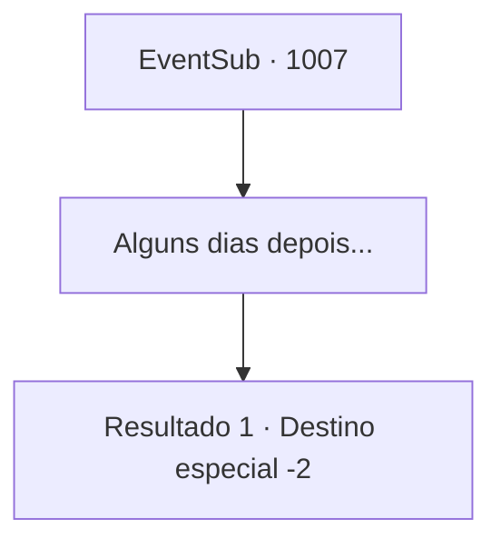

# Eventos secundários · 1007

[Índice da tabela](index.md) · [Índice geral](../index.md)

ID: `pt:EventSub:1007` · Fonte: `EventSub4` · Versão: 1.2.47.

Mapeamento estático dos arquivos; a disponibilidade e a execução dependem do estado da run.

## Texto do evento

*Sem texto no arquivo.*

## Dados de entrada

```json
{
  "id": 1007,
  "grade": 1,
  "subEvent": "",
  "required": ""
}
```

## Mapa das escolhas



## Escolhas e resultados

### Escolha 1

Alguns dias depois...

Requisitos e outros campos da escolha:

```json
{
  "required": ""
}
```

#### Resultado 1.1

Alguns dias depois, um dos servos do Conde o acompanha até a sala de audiências, onde você se encontra com o Conde mais uma vez. 

 "Devo agradecê-lo pessoalmente, {1}. É tudo graças a você que meu filho Edward está de volta são e salvo também."

 Ao lado de Ronan estão Edward e Lupin. Eles levantam as mãos para que você saiba que estão felizes em vê-lo. Ronan continua. 

 "Minha Casa não é exatamente conhecida por suas riquezas, mas temos raízes que remontam a uma linhagem de um grande guerreiro. História de orgulho, eu diria."

 Ele continua, mostrando-lhe a relíquia da família. 

 "Aqui - uma lança ancestral, passada por gerações. Ah, e um pouco de ouro, do meu tesouro pessoal. Mais uma vez, agradeço de coração."

 O Conde se inclina para agradecê-lo mais uma vez.

Continuação registrada: [Destino especial `-2`](../destinos-especiais.md).

```json
{
  "required": "",
  "chance": "1",
  "nextEvent": -2,
  "type": 2,
  "reward": "3_367_1|0_4_200|12_12_-1|14_12_1|14_12_3"
}
```

## Referências que chegam a este evento

- [Evento 1006 · escolha 1 · resultado 1](1006.md#escolha-1)
- [Evento 1006 · escolha 1 · resultado 3](1006.md#escolha-1)
- [Evento 1012 · escolha 1 · resultado 1](1012.md#escolha-1)
- [Evento 1016 · escolha 1 · resultado 1](1016.md#escolha-1)
