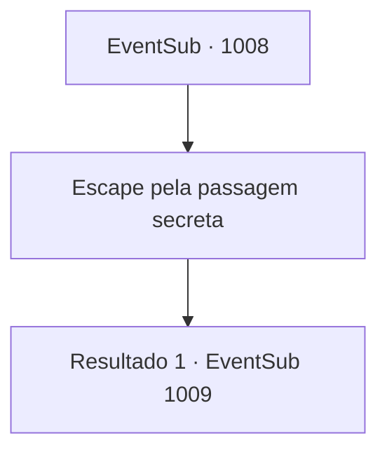

# Eventos secundários · 1008

[Índice da tabela](index.md) · [Índice geral](../index.md)

ID: `pt:EventSub:1008` · Fonte: `EventSub4` · Versão: 1.2.47.

Mapeamento estático dos arquivos; a disponibilidade e a execução dependem do estado da run.

## Texto do evento

*Sem texto no arquivo.*

## Dados de entrada

```json
{
  "id": 1008,
  "grade": 1,
  "subEvent": "",
  "required": ""
}
```

## Mapa das escolhas



## Escolhas e resultados

### Escolha 1

Escape pela passagem secreta

Requisitos e outros campos da escolha:

```json
{
  "required": ""
}
```

#### Resultado 1.1

Você e Irema passam pela caverna de pedra mal iluminada e chegam a um caminho na montanha. 

 "...Meu amor..."

 Irema dá uma última olhada para o castelo do Conde. Então, ela vira as costas para o castelo, enxugando as lágrimas dos olhos. 

 "Lá. Deve ser a direção de onde Lupin está vindo. Ouvi dizer que ele está a caminho do condado agora, com Edward."

 Você e Irema caminham para o caminho por onde se espera que Lupin passe. Então, vocês ouvem passos vindo do caminho secreto. 

 "Precisamos nos apressar!"

 Grita Irema.

Continuação registrada: [Evento 1009](1009.md) na mesma tabela.

```json
{
  "required": "",
  "chance": "1",
  "nextEvent": 1009,
  "type": 2,
  "reward": ""
}
```

## Referências que chegam a este evento

- [Evento 1006 · escolha 2 · resultado 1](1006.md#escolha-2)
- [Evento 1006 · escolha 2 · resultado 2](1006.md#escolha-2)
- [Evento 1014 · escolha 2 · resultado 1](1014.md#escolha-2)
- [Evento 1014 · escolha 2 · resultado 2](1014.md#escolha-2)
- [Evento 1015 · escolha 2 · resultado 1](1015.md#escolha-2)
- [Evento 1016 · escolha 2 · resultado 1](1016.md#escolha-2)
