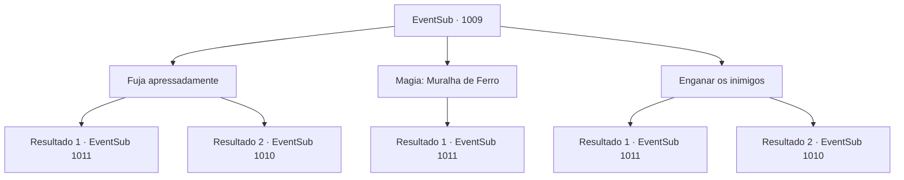

# Eventos secundários · 1009

[Índice da tabela](index.md) · [Índice geral](../index.md)

ID: `pt:EventSub:1009` · Fonte: `EventSub4` · Versão: 1.2.47.

Mapeamento estático dos arquivos; a disponibilidade e a execução dependem do estado da run.

## Texto do evento

*Sem texto no arquivo.*

## Dados de entrada

```json
{
  "id": 1009,
  "grade": 1,
  "subEvent": "",
  "required": ""
}
```

## Mapa das escolhas



## Escolhas e resultados

### Escolha 1

Fuja apressadamente

Requisitos e outros campos da escolha:

```json
{
  "required": ""
}
```

#### Resultado 1.1

Você corre pelo caminho da montanha com Irema. Finalmente, você consegue escapar da perseguição. 

 "*ofegante*... *ofegante*... Nunca na minha vida eu tive que... *ofegante*... correr assim..."

 Irema tenta desesperadamente recuperar o fôlego. Você percebe que ela está exausta. Você continua andando, ajudando Irema também. Não muito tempo depois, vocês dois encontram Lupin a cavalo. Ele deve estar a caminho do castelo, com Edward e um grupo de escolta de soldados. 

 "Hã?! Condessa Irema!?"

 Lupin desce apressadamente do cavalo e se ajoelha para mostrar respeito. A Condessa vê Edward e o abraça amorosamente. Ela então informa Lupin sobre o que aconteceu no castelo, instando-os a deixar a área o mais rápido possível. 

 "Esses malditos TRAIDORES...!"

 Indignado, Lupin tenta voltar ao castelo sozinho, mas Irema e os outros soldados conseguem detê-lo. 

 "Os rebeldes já tomaram o controle do castelo. Entrar lá sozinho não fará muita diferença."


Continuação registrada: [Evento 1011](1011.md) na mesma tabela.

```json
{
  "required": "",
  "chance": "1|0_6_1",
  "nextEvent": 1011,
  "type": 0,
  "reward": ""
}
```

#### Resultado 1.2

Você tenta fugir, mas os soldados são mais rápidos. Eles encurralam você e Irema com lanças. 

 "V- VOCÊS TRAIDORES...! COMO OUSAM!"

 O rosto de Irema escurece de medo e raiva. Mas os soldados rebeldes respondem com um simples sorriso de escárnio. 

 "Vamos garantir que você tenha um túmulo luxuoso."

 Então, todos avançam contra você com suas lanças erguidas.

Continuação registrada: [Evento 1010](1010.md) na mesma tabela.

```json
{
  "required": "",
  "chance": "14",
  "nextEvent": 1010,
  "type": 1,
  "reward": "6_3_135",
  "place": 1
}
```

### Escolha 2

Magia: Muralha de Ferro

Requisitos e outros campos da escolha:

```json
{
  "required": "20_0_3|1_1_2"
}
```

#### Resultado 2.1

Você conjura uma parede mágica, selando a passagem. Irema comenta admirada. 

 "Isso vai mantê-los afastados para sempre. Obrigada. Mas precisamos nos apressar. Lupin não terá ideia do que está acontecendo no castelo."

 Você e Irema continuam em frente. Não muito tempo depois, vocês dois encontram Lupin a cavalo. Ele deve estar a caminho do castelo, com Edward e um grupo de escolta de soldados. 

 "Hã?! Condessa Irema!?"

 Lupin desce apressadamente do cavalo e se ajoelha para mostrar respeito. A Condessa vê Edward e o abraça amorosamente. Ela então informa Lupin sobre o que aconteceu no castelo, instando-os a deixar a área o mais rápido possível. 

 "Esses malditos TRAIDORES...!"

 Indignado, Lupin tenta voltar ao castelo sozinho, mas Irema e os outros soldados conseguem detê-lo. 

 "Os rebeldes já tomaram o controle do castelo. Entrar lá sozinho não fará muita diferença."


Continuação registrada: [Evento 1011](1011.md) na mesma tabela.

```json
{
  "required": "",
  "chance": "1",
  "nextEvent": 1011,
  "type": 2,
  "reward": "0_1_-1"
}
```

### Escolha 3

Enganar os inimigos

Requisitos e outros campos da escolha:

```json
{
  "required": ""
}
```

#### Resultado 3.1

Você rapidamente empurra Irema para um arbusto próximo e então coloca o disfarce de um herbalista local. Logo, um grupo de soldados começa a vasculhar a área e se aproxima de você. 

 "Ei, herbalista. Você viu uma mulher passando por aqui agora há pouco? Uma com cabelo branco-prateado?"

 Você aponta para o sul com o dedo. Os soldados imediatamente correm naquela direção sem levantar suspeitas. Depois que todos os soldados se foram, Irema sai do arbusto. Ela comenta, tirando as folhas do vestido. 

 "Você tem muitos talentos, pelo que vejo. Nunca joguei esconde-esconde assim, desde que era criança. Conseguimos enganar os soldados, mas precisamos nos apressar. Lupin não terá ideia do que está acontecendo no castelo."

 Você e Irema continuam em frente. Não muito tempo depois, vocês dois encontram Lupin a cavalo. Ele deve estar a caminho do castelo, com Edward e um grupo de escolta de soldados. 

 "Hã?! Condessa Irema!?"

 Lupin rapidamente desce do cavalo e se ajoelha para mostrar respeito. A Condessa vê Edward e o abraça amorosamente. Ela então informa Lupin sobre o que aconteceu no castelo, instando-os a deixar a área o mais rápido possível. 

 "Esses malditos TRAIDORES...!"

 Indignado, Lupin tenta voltar ao castelo sozinho, mas Irema e os outros soldados conseguem detê-lo. 

 "Os rebeldes já tomaram o controle do castelo. Entrar lá sozinho não fará muita diferença."


Continuação registrada: [Evento 1011](1011.md) na mesma tabela.

```json
{
  "required": "",
  "chance": "1|0_12_1",
  "nextEvent": 1011,
  "type": 0,
  "reward": ""
}
```

#### Resultado 3.2

Você apressa-se em empurrar Irema para um arbusto próximo e, em seguida, coloca o disfarce de um herbalista local. Logo, um grupo de soldados começa a vasculhar a área, nota você e grita. 

 "AQUI!"


Continuação registrada: [Evento 1010](1010.md) na mesma tabela.

```json
{
  "required": "",
  "chance": "14",
  "nextEvent": 1010,
  "type": 1,
  "reward": "6_3_135",
  "place": 1
}
```

## Referências que chegam a este evento

- [Evento 1008 · escolha 1 · resultado 1](1008.md#escolha-1)
