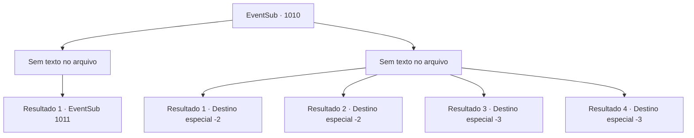

# Eventos secundários · 1010

[Índice da tabela](index.md) · [Índice geral](../index.md)

ID: `pt:EventSub:1010` · Fonte: `EventSub4` · Versão: 1.2.47.

Mapeamento estático dos arquivos; a disponibilidade e a execução dependem do estado da run.

## Texto do evento

*Sem texto no arquivo.*

## Dados de entrada

```json
{
  "id": 1010,
  "grade": 1,
  "subEvent": "",
  "required": ""
}
```

## Mapa das escolhas



## Escolhas e resultados

### Escolha 1

*Sem texto no arquivo; o papel dessa opção depende da interface do jogo.*

Requisitos e outros campos da escolha:

```json
{
  "required": ""
}
```

#### Resultado 1.1

Você lida com os soldados perseguidores. Irema lhes dá um olhar de pena. 

 "...Precisamos nos apressar. Lupin não terá ideia do que está acontecendo no castelo."

 Você e Irema continuam em frente. Não muito tempo depois, vocês dois encontram Lupin a cavalo. Ele deve estar a caminho do castelo, com Edward e um grupo de escolta de soldados. 

 "Hã?! Condessa Irema!?"

 Lupin desce apressadamente de seu cavalo e se ajoelha para mostrar respeito. A Condessa vê Edward e o abraça amorosamente. Ela então informa Lupin sobre o que aconteceu no castelo, instando-os a deixar a área o mais rápido possível. 

 "Esses malditos TRAIDORES...!"

 Indignado, Lupin tenta voltar ao castelo sozinho, mas Irema e os outros soldados conseguem detê-lo. 

 "Os rebeldes já tomaram o controle do castelo. Entrar lá sozinho não fará muita diferença."


Continuação registrada: [Evento 1011](1011.md) na mesma tabela.

```json
{
  "required": "",
  "chance": "1",
  "nextEvent": 1011,
  "type": 2,
  "reward": ""
}
```

### Escolha 2

*Sem texto no arquivo; o papel dessa opção depende da interface do jogo.*

Requisitos e outros campos da escolha:

```json
{
  "required": ""
}
```

#### Resultado 2.1

Esfaqueado aqui e ali com as lanças dos soldados, você é jogado no chão. Eles te jogam sem pensar em um arbusto próximo, depois capturam Irema. 

 "N- NÃO...!!"

 Ela luta desesperadamente por liberdade, mas é levada embora. Logo, você perde a consciência.  Você finalmente abre os olhos novamente. Olhando ao redor, percebe que é noite, sem sinal de outras pessoas por perto. Você segura suas feridas para mitigar o sangramento, então se afasta do castelo do Conde.

Continuação registrada: [Destino especial `-2`](../destinos-especiais.md).

```json
{
  "required": "1_0_2|1_1_2|5_798_1",
  "chance": "1",
  "nextEvent": -2,
  "type": 2,
  "reward": "0_0_-1|0_1_-1|12_12_-1|14_12_4"
}
```

#### Resultado 2.2

Esfaqueado aqui e ali com as lanças dos soldados, você é jogado no chão. Eles te jogam sem pensar em um arbusto próximo, depois capturam Irema. 

 "N- NÃO...!!"

 Ela luta desesperadamente por liberdade, mas é levada embora. Logo, você perde a consciência.  Você finalmente abre os olhos novamente. Olhando ao redor, percebe que é noite, sem sinal de outras pessoas por perto. Você segura suas feridas para mitigar o sangramento, então se afasta do castelo do Conde.

Continuação registrada: [Destino especial `-2`](../destinos-especiais.md).

```json
{
  "required": "1_0_2|1_1_2|18_798_1",
  "chance": "1",
  "nextEvent": -2,
  "type": 2,
  "reward": "0_0_-1|0_1_-1|12_12_-1|14_12_5"
}
```

#### Resultado 2.3

Esfaqueado aqui e ali com as lanças dos soldados, você é jogado no chão. Eles te jogam sem pensar em um arbusto próximo, depois capturam Irema. 

 "N- NÃO...!!"

 Ela luta desesperadamente por liberdade, mas é levada embora. Logo, você perde a consciência.

Continuação registrada: [Destino especial `-3`](../destinos-especiais.md).

```json
{
  "required": "2_0_2",
  "chance": "1",
  "nextEvent": -3,
  "type": 2,
  "reward": "0_0_-1|0_1_-1"
}
```

#### Resultado 2.4

Esfaqueado aqui e ali com as lanças dos soldados, você é jogado no chão. Eles te jogam sem pensar em um arbusto próximo, depois capturam Irema. 

 "N- NÃO...!!"

 Ela luta desesperadamente por liberdade, mas é levada embora. Logo, você perde a consciência.

Continuação registrada: [Destino especial `-3`](../destinos-especiais.md).

```json
{
  "required": "2_1_2",
  "chance": "1",
  "nextEvent": -3,
  "type": 2,
  "reward": "0_0_-1|0_1_-1"
}
```

## Referências que chegam a este evento

- [Evento 1009 · escolha 1 · resultado 2](1009.md#escolha-1)
- [Evento 1009 · escolha 3 · resultado 2](1009.md#escolha-3)
