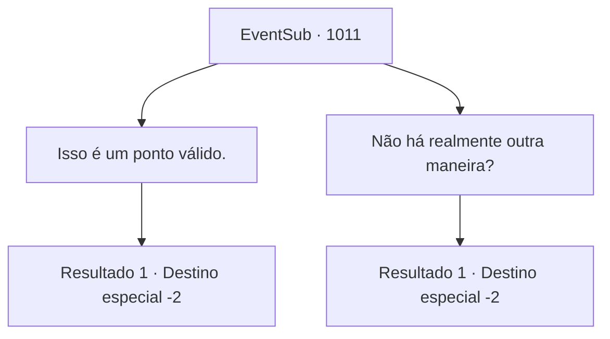

# Eventos secundários · 1011

[Índice da tabela](index.md) · [Índice geral](../index.md)

ID: `pt:EventSub:1011` · Fonte: `EventSub4` · Versão: 1.2.47.

Mapeamento estático dos arquivos; a disponibilidade e a execução dependem do estado da run.

## Texto do evento

*Sem texto no arquivo.*

## Dados de entrada

```json
{
  "id": 1011,
  "grade": 1,
  "subEvent": "",
  "required": ""
}
```

## Mapa das escolhas



## Escolhas e resultados

### Escolha 1

Isso é um ponto válido.

Requisitos e outros campos da escolha:

```json
{
  "required": "5_798_1"
}
```

#### Resultado 1.1

Você concorda com Irema. Lupin consegue se acalmar, então fala. 

 "...Então, qual é nosso próximo passo, Condessa Irema?"

 Ela responde a Lupin. 

 "Primeiramente, eu estava pensando em fazer uma visita ao 'Duque Lutherinia' - meu pai. Presumo que esse seja o lugar mais seguro para eu planejar o que fazer. E então..."

 Ela volta seu olhar para você. 

 "Agradeço por tudo que você fez por nós, {1}. Esta é a única maneira que posso mostrar minha gratidão agora..."

 Ela tira seu broche do vestido e entrega a você. 

 "Este é o dote que recebi de Ronan no dia do nosso casamento. Tenho certeza de que valerá um bom preço. Só espero que possa ser útil para você."

 Ela se inclina graciosamente para agradecer. Edward faz o mesmo. Irema, Lupin e Edward se viram e partem.

Continuação registrada: [Destino especial `-2`](../destinos-especiais.md).

```json
{
  "required": "",
  "chance": "1",
  "nextEvent": -2,
  "type": 2,
  "reward": "3_368_1|12_12_-1|14_12_4"
}
```

### Escolha 2

Não há realmente outra maneira?

Requisitos e outros campos da escolha:

```json
{
  "required": "18_798_1"
}
```

#### Resultado 2.1

Você e Lupin tentam elaborar um plano para tomar o castelo, mas Irema permanece inflexível. 

 "Não... Eu não posso perder Lupin também. Além disso, nem mesmo os rebeldes poderão tratar meu marido como um ninguém."

 Lupin consegue se acalmar, então fala. 

 "...Então, qual é o nosso próximo passo, Condessa Irema?"

 Ela responde a Lupin. 

 "Primeiramente, eu estava pensando em fazer uma visita ao 'Duque Lutherinia' - meu pai. Presumo que esse seja o lugar mais seguro para eu planejar o que fazer. E então..."

 Ela volta seu olhar para você. 

 "Agradeço por tudo que você fez por nós, {1}. Esta é a única maneira que posso mostrar minha gratidão agora..."

 Ela tira seu broche do vestido e entrega a você. 

 "Este é o dote que recebi de Ronan no dia do nosso casamento. Tenho certeza de que valerá um bom preço. Só espero que possa ser útil para você."

 Ela se inclina graciosamente para agradecer. Edward faz o mesmo. Irema, Lupin e Edward se viram e partem.

Continuação registrada: [Destino especial `-2`](../destinos-especiais.md).

```json
{
  "required": "",
  "chance": "1",
  "nextEvent": -2,
  "type": 2,
  "reward": "3_368_1|12_12_-1|14_12_5"
}
```

## Referências que chegam a este evento

- [Evento 1009 · escolha 1 · resultado 1](1009.md#escolha-1)
- [Evento 1009 · escolha 2 · resultado 1](1009.md#escolha-2)
- [Evento 1009 · escolha 3 · resultado 1](1009.md#escolha-3)
- [Evento 1010 · escolha 1 · resultado 1](1010.md#escolha-1)
