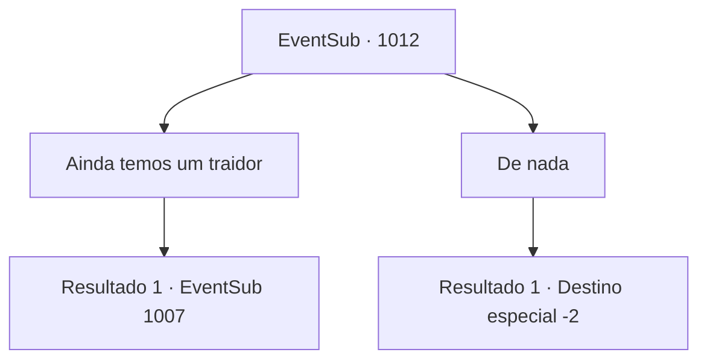

# Eventos secundários · 1012

[Índice da tabela](index.md) · [Índice geral](../index.md)

ID: `pt:EventSub:1012` · Fonte: `EventSub4` · Versão: 1.2.47.

Mapeamento estático dos arquivos; a disponibilidade e a execução dependem do estado da run.

## Texto do evento

*Sem texto no arquivo.*

## Dados de entrada

```json
{
  "id": 1012,
  "grade": 1,
  "subEvent": "",
  "required": ""
}
```

## Mapa das escolhas



## Escolhas e resultados

### Escolha 1

Ainda temos um traidor

Requisitos e outros campos da escolha:

```json
{
  "required": "8_365_1"
}
```

#### Resultado 1.1

Você tira uma carta do bolso e a entrega ao Conde Ronan. Os olhos do Conde se arregalam ao ler a carta. 

 "I- isto é... HAZEL...! COMO VOCÊ PÔDE?!"

 Seu rosto fica vermelho de raiva. Ele joga a carta no rosto de Hazel, depois bate em uma mesa próxima, jogando documentos de papel no ar. Mas Hazel ainda não admitiu sua culpa. 

 "N- NÃO! Você não vê, meu amor, que esta carta é FALSA?! Você está realmente acreditando nas palavras de um estranho em vez das minhas!?"

 Mas o Conde está decidido. 

 "Hazel Radichevski. Você está aqui sentenciada por traição. O que estão fazendo?! Prendam-na imediatamente!"

 Os soldados seguem a ordem do Conde, arrastando Hazel para o porão. Ele lava o suor do rosto e solta um longo suspiro, como se o cansaço e o estresse mental finalmente tivessem cobrado seu preço. O Conde desaba no chão. 

 "*suspiro*... Estou cansado. Por favor, espere um segundo."

 Irema ajuda o Conde a se levantar. Então, o Conde volta para o seu quarto. O mordomo pessoal de Ronan se dirige a você. 

 "O Conde deve estar em estado de choque. Por favor, dê-lhe um minuto."


Continuação registrada: [Evento 1007](1007.md) na mesma tabela.

```json
{
  "required": "",
  "chance": "1",
  "nextEvent": 1007,
  "type": 2,
  "reward": ""
}
```

### Escolha 2

De nada

Requisitos e outros campos da escolha:

```json
{
  "required": ""
}
```

#### Resultado 2.1

O Conde pede que você tenha paciência enquanto os servos limpam e organizam o castelo. Seu mordomo pessoal o acompanha até o quarto de hóspedes. Algumas horas depois, você é convocado mais uma vez pelo Conde para a sala de audiência. 

 "Devo agradecê-lo pessoalmente, {1}. É tudo graças a você que meu filho Edward está de volta são e salvo também."

 Ao lado de Ronan estão Edward e Lupin. Eles levantam as mãos para que você saiba que estão felizes em vê-lo. Ronan continua. 

 "Minha Casa não é exatamente conhecida por suas riquezas, mas temos raízes que remontam a uma linhagem de um grande guerreiro. História de orgulho, eu diria."

 Ele continua, mostrando-lhe a relíquia de família. 

 "Aqui - uma lança ancestral, passada por gerações. Ah, e um pouco de ouro, do meu acervo pessoal. Mais uma vez, agradeço de coração."

 O Conde se inclina para agradecê-lo mais uma vez.

Continuação registrada: [Destino especial `-2`](../destinos-especiais.md).

```json
{
  "required": "",
  "chance": "1",
  "nextEvent": -2,
  "type": 2,
  "reward": "3_367_1|0_4_200|12_12_-1|14_12_1|14_12_7"
}
```

## Referências que chegam a este evento

- [Evento 1006 · escolha 1 · resultado 2](1006.md#escolha-1)
