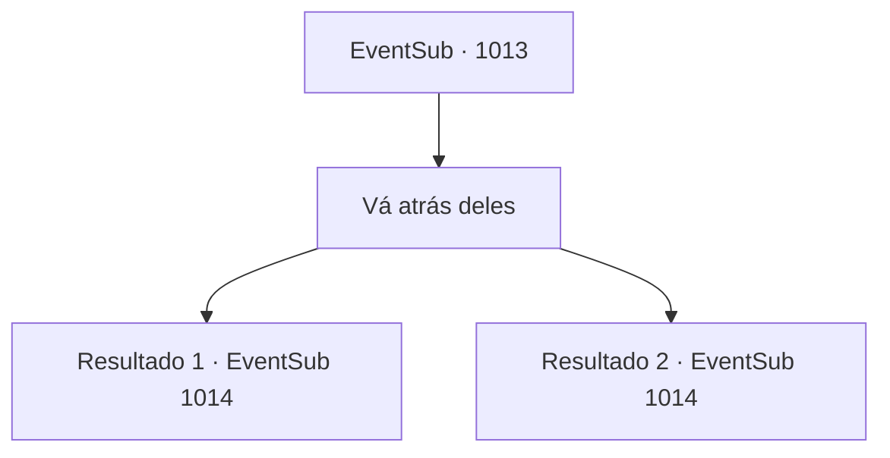

# Eventos secundários · 1013

[Índice da tabela](index.md) · [Índice geral](../index.md)

ID: `pt:EventSub:1013` · Fonte: `EventSub4` · Versão: 1.2.47.

Mapeamento estático dos arquivos; a disponibilidade e a execução dependem do estado da run.

## Texto do evento

*Sem texto no arquivo.*

## Dados de entrada

```json
{
  "id": 1013,
  "grade": 1,
  "subEvent": "",
  "required": ""
}
```

## Mapa das escolhas



## Escolhas e resultados

### Escolha 1

Vá atrás deles

Requisitos e outros campos da escolha:

```json
{
  "required": ""
}
```

#### Resultado 1.1

Você os segue silenciosamente. Eles se dirigem ao canto mais profundo da adega de vinhos, derrubam as paredes de tijolos para revelar um caminho secreto. O grupo desaparece imediatamente na passagem oculta. Você faz o mesmo, entrando no caminho secreto. Quando finalmente chega ao fim da passagem, você se depara com Lukas, o homem com a espada larga e os soldados sob seu comando, envolvidos em um confronto com o Conde e suas duas esposas. Lukas cai na gargalhada, então fala. 

 "Acabou, Ronan. Renda-se já."

 Você percebe que o Conde está surpreso. 

 "Lukas, Milorad... Como vocês sabem sobre a passagem secreta? Hazel? Você contou a eles?"

 A mulher chamada Hazel permanece em silêncio. Então, o homem com a espada larga - que deve ser Milorad - te avista. 

 "Ah, parece que temos um convidado não convidado."

 Ele então ordena que seus soldados lidem com você. 

 "Eliminem esse. Eu cuidarei do Conde."

 O Conde puxa sua espada, furioso. 

 "Milorad...! VOCÊ OUSA USAR ESSE TRUQUE SUJO CONTRA MIM?!"

 O duelo entre Milorad e o Conde começa, e assim também sua luta contra os soldados.

Continuação registrada: [Evento 1014](1014.md) na mesma tabela.

```json
{
  "required": "18_798_1",
  "chance": "1",
  "nextEvent": 1014,
  "type": 2,
  "reward": "6_0_135",
  "place": 6
}
```

#### Resultado 1.2

Você os segue silenciosamente. Eles se dirigem ao canto mais profundo da adega de vinhos, derrubam as paredes de tijolos para revelar um caminho secreto. O grupo desaparece imediatamente na passagem oculta. Você faz o mesmo, entrando no caminho secreto. Quando finalmente chega ao fim da passagem, você se depara com o homem com a espada larga e os soldados sob seu comando, envolvidos em um confronto com o Conde e suas duas esposas. Você percebe que o Conde está surpreso. 

 "Milorad, como você sabe sobre a passagem secreta? Hazel? Você contou a ele?"

 A mulher chamada Hazel permanece em silêncio. Então, o homem com a espada larga - que deve ser Milorad - te avista. 

 "Ah, parece que temos um convidado não convidado."

 Ele então ordena que seus soldados lidem com você. 

 "Livrem-se desse. Eu cuidarei do Conde."

 O Conde puxa sua espada, furioso. 

 "Milorad...! VOCÊ OUSA USAR ESSE TRUQUE SUJO CONTRA MIM?!"

 O duelo entre Milorad e o Conde começa, assim como sua luta contra os soldados.

Continuação registrada: [Evento 1014](1014.md) na mesma tabela.

```json
{
  "required": "5_798_1",
  "chance": "1",
  "nextEvent": 1014,
  "type": 2,
  "reward": "6_0_135",
  "place": 6
}
```

## Referências que chegam a este evento

- [Evento 1002 · escolha 1 · resultado 1](1002.md#escolha-1)
- [Evento 1002 · escolha 1 · resultado 2](1002.md#escolha-1)
- [Evento 1002 · escolha 2 · resultado 1](1002.md#escolha-2)
- [Evento 1002 · escolha 2 · resultado 2](1002.md#escolha-2)
