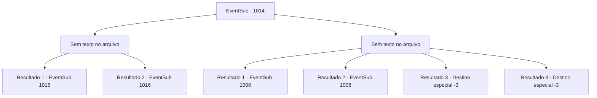

# Eventos secundários · 1014

[Índice da tabela](index.md) · [Índice geral](../index.md)

ID: `pt:EventSub:1014` · Fonte: `EventSub4` · Versão: 1.2.47.

Mapeamento estático dos arquivos; a disponibilidade e a execução dependem do estado da run.

## Texto do evento

*Sem texto no arquivo.*

## Dados de entrada

```json
{
  "id": 1014,
  "grade": 1,
  "subEvent": "",
  "required": ""
}
```

## Mapa das escolhas



## Escolhas e resultados

### Escolha 1

*Sem texto no arquivo; o papel dessa opção depende da interface do jogo.*

Requisitos e outros campos da escolha:

```json
{
  "required": ""
}
```

#### Resultado 1.1

Você derrota os soldados e então se junta ao duelo para ajudar o Conde Ronan. Milorad e Lukas não devem ter esperado por isso. 

 "Droga..."

 O Conde Ronan fala, respirando pesadamente. 

 "*ofegante*... *ofegante*... Obrigado."

 Milorad recua para recuperar a compostura também, apertando o punho na espada grande mais uma vez. 

 "Droga, Lukas. Não vai ser útil, pelo menos uma vez?"

 Ouvindo isso, Lukas puxa um chicote da cintura e se prepara para a batalha. 

 "...Droga, droga..."

 E assim, a luta recomeça.

Continuação registrada: [Evento 1015](1015.md) na mesma tabela.

```json
{
  "required": "18_798_1",
  "chance": "1",
  "nextEvent": 1015,
  "type": 2,
  "reward": "6_0_187",
  "place": 6
}
```

#### Resultado 1.2

Você derrota os soldados e então se junta ao duelo para ajudar o Conde Ronan. Milorad não devem ter esperado por isso. 

 "Droga..."

 O Conde Ronan fala, respirando pesadamente. 

 "*ofegante*... *ofegante*... Obrigado."

 Milorad recua para recuperar a compostura também, apertando o punho da espada grande mais uma vez. 

 "Vou matar vocês dois."


Continuação registrada: [Evento 1016](1016.md) na mesma tabela.

```json
{
  "required": "5_798_1",
  "chance": "1",
  "nextEvent": 1016,
  "type": 2,
  "reward": "6_2_185",
  "place": 6
}
```

### Escolha 2

*Sem texto no arquivo; o papel dessa opção depende da interface do jogo.*

Requisitos e outros campos da escolha:

```json
{
  "required": ""
}
```

#### Resultado 2.1

Milorad te derrota na batalha. Lukas cai na gargalhada. 

 "Desista, Ronan. Sua resistência é inútil."

 Ele abraça Hazel ao seu lado, zombando do Conde. 

 "Você fez tão bem, minha adorável Hazel."

 O Conde, encurralado, murmura para você desesperadamente. 

 "Sinto muito por ter duvidado de você. O verdadeiro inimigo estava lá o tempo todo..."

 Ele aponta para a passagem de onde Milorad e Lukas apareceram. 

 "Você pode sair do castelo por ali. Por favor, leve Irema para Lupin. E conte a eles o que aconteceu no castelo."

 Você corre para o caminho secreto, arrastando Irema com você. Milorad tenta te parar, mas Ronan se joga contra ele para garantir sua saída rápida.

Continuação registrada: [Evento 1008](1008.md) na mesma tabela.

```json
{
  "required": "1_0_2|1_1_2|18_798_1",
  "chance": "1",
  "nextEvent": 1008,
  "type": 2,
  "reward": "0_0_-1|0_1_-1"
}
```

#### Resultado 2.2

Milorad derrota você e o Conde na batalha. O Conde, encurralado, murmura para você desesperadamente. 

 "Sinto muito por ter duvidado de você. O verdadeiro inimigo estava lá o tempo todo..."

 Ele aponta para a passagem de onde Milorad e Lukas apareceram. 

 "Você pode sair do castelo por ali. Por favor, leve Irema para Lupin. E conte a ele o que aconteceu no castelo."

 Você corre para o caminho secreto, arrastando Irema com você. Milorad tenta impedi-lo, mas Ronan se joga contra ele para garantir sua saída rápida.

Continuação registrada: [Evento 1008](1008.md) na mesma tabela.

```json
{
  "required": "1_0_2|1_1_2|5_798_1",
  "chance": "1",
  "nextEvent": 1008,
  "type": 2,
  "reward": "0_0_-1|0_1_-1"
}
```

#### Resultado 2.3

A pesada espada larga corta seu corpo ao meio. Milorad levanta sua arma ensanguentada novamente, desta vez rachando seu crânio.

Continuação registrada: [Destino especial `-3`](../destinos-especiais.md).

```json
{
  "required": "2_0_2",
  "chance": "1",
  "nextEvent": -3,
  "type": 2,
  "reward": "0_0_-1|0_1_-1"
}
```

#### Resultado 2.4

A pesada espada larga corta seu corpo ao meio. Milorad levanta sua arma ensanguentada novamente, desta vez rachando seu crânio.

Continuação registrada: [Destino especial `-3`](../destinos-especiais.md).

```json
{
  "required": "2_1_2",
  "chance": "1",
  "nextEvent": -3,
  "type": 2,
  "reward": "0_0_-1|0_1_-1"
}
```

## Referências que chegam a este evento

- [Evento 1013 · escolha 1 · resultado 1](1013.md#escolha-1)
- [Evento 1013 · escolha 1 · resultado 2](1013.md#escolha-1)
- [Evento 1017 · escolha 2 · resultado 1](1017.md#escolha-2)
- [Evento 1017 · escolha 2 · resultado 2](1017.md#escolha-2)
- [Evento 1019 · escolha 1 · resultado 1](1019.md#escolha-1)
- [Evento 1019 · escolha 1 · resultado 2](1019.md#escolha-1)
