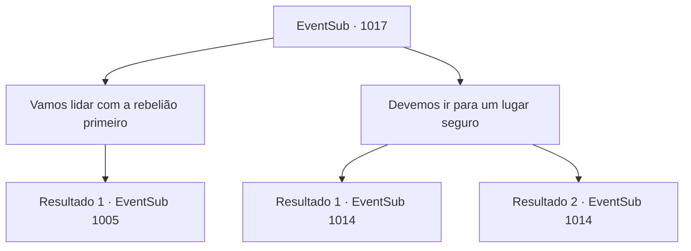

# Eventos secundários · 1017

[Índice da tabela](index.md) · [Índice geral](../index.md)

ID: `pt:EventSub:1017` · Fonte: `EventSub4` · Versão: 1.2.47.

Mapeamento estático dos arquivos; a disponibilidade e a execução dependem do estado da run.

## Texto do evento

*Sem texto no arquivo.*

## Dados de entrada

```json
{
  "id": 1017,
  "grade": 1,
  "subEvent": "",
  "required": ""
}
```

## Mapa das escolhas



## Escolhas e resultados

### Escolha 1

Vamos lidar com a rebelião primeiro

Requisitos e outros campos da escolha:

```json
{
  "required": ""
}
```

#### Resultado 1.1

Você apoia a opinião de Irema de priorizar lidar com a rebelião. Após uma longa deliberação, Conde Ronan puxa sua espada para responder. 

 "Certo. Vamos tentar, então."

 Ele se prepara para lutar contra os soldados que o serviam há apenas alguns minutos.

Continuação registrada: [Evento 1005](1005.md) na mesma tabela.

```json
{
  "required": "",
  "chance": "1",
  "nextEvent": 1005,
  "type": 2,
  "reward": "6_0_136",
  "place": 10
}
```

### Escolha 2

Devemos ir para um lugar seguro

Requisitos e outros campos da escolha:

```json
{
  "required": ""
}
```

#### Resultado 2.1

Você apoia a opinião de Hazel de buscar segurança primeiro. Após uma longa deliberação, o Conde Ronan decide aceitar sua sugestão. 

 "Vamos, então."

 Você, o Conde e suas esposas entram na passagem secreta, localizada atrás de uma das estantes. No caminho fracamente iluminado, há escadas conectadas ao porão. Tochas distantes fornecem luz, fraca mas suficiente para a navegação. Enquanto seu grupo avança pelo corredor mofado, a parede de pedra de repente se quebra, revelando Lukas e o homem com a grande espada. Acompanhados por alguns soldados sob seu comando, eles bloqueiam seu avanço. Os olhos do Conde se arregalam ao verificar seus rostos. 

 "Bispo Lukas...! Milorad!"

 Lukas explode em uma risada sarcástica. 

 "Acabou, Ronan. Renda-se já."

 Você percebe que o Conde está surpreso. 

 "Lukas, Milorad... Como vocês sabem sobre a passagem secreta? Hazel? Você contou a eles?"

 A mulher chamada Hazel permanece em silêncio. Então, o homem com a grande espada - que deve ser Milorad - prepara sua arma, dirigindo-se aos seus soldados. 

 "Eliminem aquele. Eu cuidarei do Conde."

 O Conde puxa sua espada, furioso. 

 "Milorad...! VOCÊ OUSA USAR ESTE TRUQUE SUJO CONTRA MIM?!"

 O duelo entre Milorad e o Conde começa, assim como sua luta contra os soldados.

Continuação registrada: [Evento 1014](1014.md) na mesma tabela.

```json
{
  "required": "18_798_1",
  "chance": "1",
  "nextEvent": 1014,
  "type": 2,
  "reward": "6_0_135",
  "place": 6
}
```

#### Resultado 2.2

Você apoia a opinião de Hazel de buscar segurança primeiro. Após uma longa deliberação, o Conde Ronan decide aceitar sua sugestão. 

 "Vamos, então."

 Você, o Conde e suas esposas entram na passagem secreta, localizada atrás de uma das estantes. No caminho fracamente iluminado, há escadas conectadas ao porão. Tochas distantes fornecem luz, fraca, mas suficiente para a navegação. Enquanto seu grupo avança pelo corredor mofado, a parede de pedra de repente se quebra, revelando o homem com a grande espada. Acompanhado por alguns soldados sob seu comando, ele está bloqueando seu avanço. Você percebe que o Conde está surpreso. 

 "Milorad... Como você sabe sobre a passagem secreta? Hazel? Você contou a ele?"

 A mulher chamada Hazel permanece em silêncio. Então, o homem com a grande espada - que deve ser Milorad - prepara sua arma, dirigindo-se aos seus soldados. 

 "Eliminem aquele. Eu cuidarei do Conde."

 O Conde puxa sua espada, furioso. 

 "Milorad...! VOCÊ OUSA USAR ESTE TRUQUE SUJO CONTRA MIM?!"

 O duelo entre Milorad e o Conde começa, assim como sua luta contra os soldados.

Continuação registrada: [Evento 1014](1014.md) na mesma tabela.

```json
{
  "required": "5_798_1",
  "chance": "1",
  "nextEvent": 1014,
  "type": 2,
  "reward": "6_0_135",
  "place": 6
}
```

## Referências que chegam a este evento

- [Evento 1004 · escolha 2 · resultado 1](1004.md#escolha-2)
