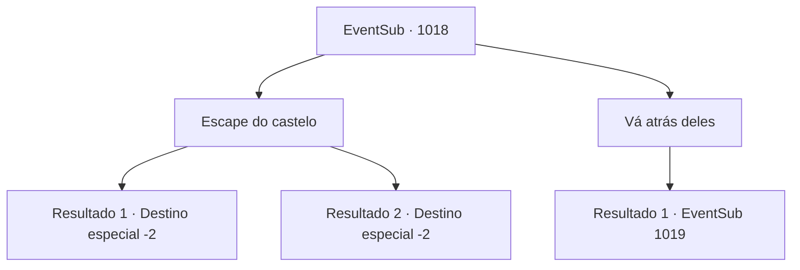

# Eventos secundários · 1018

[Índice da tabela](index.md) · [Índice geral](../index.md)

ID: `pt:EventSub:1018` · Fonte: `EventSub4` · Versão: 1.2.47.

Mapeamento estático dos arquivos; a disponibilidade e a execução dependem do estado da run.

## Texto do evento

*Sem texto no arquivo.*

## Dados de entrada

```json
{
  "id": 1018,
  "grade": 1,
  "subEvent": "",
  "required": ""
}
```

## Mapa das escolhas



## Escolhas e resultados

### Escolha 1

Escape do castelo

Requisitos e outros campos da escolha:

```json
{
  "required": ""
}
```

#### Resultado 1.1

Você ouve as palavras de Ronan, abandonando a perseguição. Em vez disso, você deixa os terrenos caóticos do castelo.

Continuação registrada: [Destino especial `-2`](../destinos-especiais.md).

```json
{
  "required": "18_798_1",
  "chance": "1",
  "nextEvent": -2,
  "type": 2,
  "reward": "12_12_-1|14_12_5"
}
```

#### Resultado 1.2

Você ouve as palavras de Ronan, abandonando a perseguição. Em vez disso, você deixa os terrenos caóticos do castelo.

Continuação registrada: [Destino especial `-2`](../destinos-especiais.md).

```json
{
  "required": "5_798_1",
  "chance": "1",
  "nextEvent": -2,
  "type": 2,
  "reward": "12_12_-1|14_12_4"
}
```

### Escolha 2

Vá atrás deles

Requisitos e outros campos da escolha:

```json
{
  "required": ""
}
```

#### Resultado 2.1

Você segue a família do Conde. Eles estão com tanta pressa que nem percebem que estão sendo seguidos. Depois de revelar uma passagem secreta escondida atrás de uma das estantes, eles desaparecem no caminho. Você espera alguns segundos antes de segui-los pelo novo caminho. Dispostas no caminho mal iluminado estão escadas, conectadas ao porão. Tochas distantes fornecem luz, fraca mas suficiente para navegação. Enquanto você avança pelo corredor mofado, ouve o som das paredes de pedra se desmoronando.

Continuação registrada: [Evento 1019](1019.md) na mesma tabela.

```json
{
  "required": "",
  "chance": "1",
  "nextEvent": 1019,
  "type": 2,
  "reward": "6_0_135",
  "place": 6
}
```

## Referências que chegam a este evento

- [Evento 1004 · escolha 2 · resultado 2](1004.md#escolha-2)
