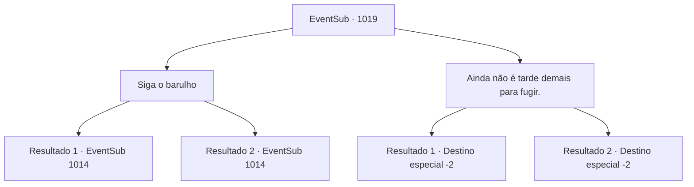

# Eventos secundários · 1019

[Índice da tabela](index.md) · [Índice geral](../index.md)

ID: `pt:EventSub:1019` · Fonte: `EventSub4` · Versão: 1.2.47.

Mapeamento estático dos arquivos; a disponibilidade e a execução dependem do estado da run.

## Texto do evento

*Sem texto no arquivo.*

## Dados de entrada

```json
{
  "id": 1019,
  "grade": 1,
  "subEvent": "",
  "required": ""
}
```

## Mapa das escolhas



## Escolhas e resultados

### Escolha 1

Siga o barulho

Requisitos e outros campos da escolha:

```json
{
  "required": ""
}
```

#### Resultado 1.1

Você corre em direção ao som. Lá, você se depara não apenas com a parede de pedra destruída, mas também com Lukas, o homem com a espada larga, e os soldados sob seu comando, envolvidos em um confronto com o Conde e suas duas esposas. Você percebe que o Conde está surpreso. 

 "Milorad... Como você sabe sobre a passagem secreta? Hazel? Você contou a ele?"

 A mulher chamada Hazel permanece em silêncio. Então, o homem com a espada larga - que deve ser Milorad - te avista. 

 "Ah, parece que temos um convidado não convidado."

 O Conde olha para trás. Ao notar você, ele desesperadamente pede sua ajuda. 

 "Eu estava errado. Por favor - preciso da sua ajuda."

 O Conde puxa sua espada para enfrentar Milorad. Os soldados de Milorad avançam em sua direção.

Continuação registrada: [Evento 1014](1014.md) na mesma tabela.

```json
{
  "required": "18_798_1",
  "chance": "1",
  "nextEvent": 1014,
  "type": 2,
  "reward": "6_0_135",
  "place": 6
}
```

#### Resultado 1.2

Você corre em direção ao som. Lá, você se depara não apenas com a parede de pedra destruída, mas também com o homem com a espada larga e os soldados sob seu comando, envolvidos em um impasse com o Conde e suas duas esposas. Você percebe que o Conde está surpreso. 

 "Milorad... Como você sabe sobre a passagem secreta? Hazel? Você contou a ele?"

 A mulher chamada Hazel permanece em silêncio. Então, o homem com a espada larga - que deve ser Milorad - te avista. 

 "Ah, parece que temos um convidado não convidado."

 Ele então ordena que seus soldados te matem. 

 "Lidem com esse. Eu cuidarei do Conde."

 O Conde puxa sua espada, furioso. 

 "Milorad...! VOCÊ OUSA USAR ESSE TRUQUE SUJO CONTRA MIM?!"

 O duelo entre Milorad e o Conde começa, assim como sua luta contra os soldados.

Continuação registrada: [Evento 1014](1014.md) na mesma tabela.

```json
{
  "required": "5_798_1",
  "chance": "1",
  "nextEvent": 1014,
  "type": 2,
  "reward": "6_0_135",
  "place": 6
}
```

### Escolha 2

Ainda não é tarde demais para fugir.

Requisitos e outros campos da escolha:

```json
{
  "required": ""
}
```

#### Resultado 2.1

Você toma uma decisão e volta, afastando-se dos terrenos caóticos do castelo.

Continuação registrada: [Destino especial `-2`](../destinos-especiais.md).

```json
{
  "required": "18_798_1",
  "chance": "1",
  "nextEvent": -2,
  "type": 2,
  "reward": "12_12_-1|14_12_5"
}
```

#### Resultado 2.2

Você toma uma decisão e volta, afastando-se dos terrenos caóticos do castelo.

Continuação registrada: [Destino especial `-2`](../destinos-especiais.md).

```json
{
  "required": "5_798_1",
  "chance": "1",
  "nextEvent": -2,
  "type": 2,
  "reward": "12_12_-1|14_12_4"
}
```

## Referências que chegam a este evento

- [Evento 1018 · escolha 2 · resultado 1](1018.md#escolha-2)
