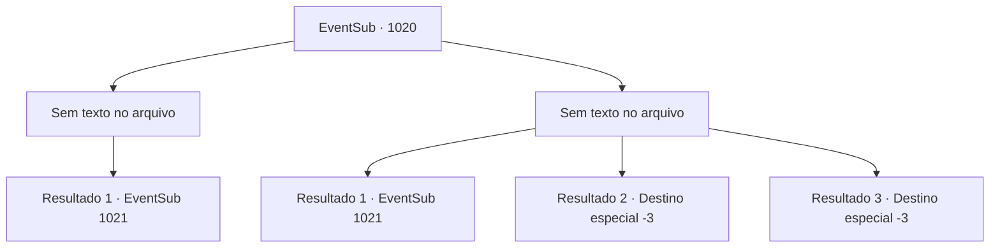

# Eventos secundários · 1020

[Índice da tabela](index.md) · [Índice geral](../index.md)

ID: `pt:EventSub:1020` · Fonte: `EventSub4` · Versão: 1.2.47.

Mapeamento estático dos arquivos; a disponibilidade e a execução dependem do estado da run.

## Texto do evento

*Sem texto no arquivo.*

## Dados de entrada

```json
{
  "id": 1020,
  "grade": 1,
  "subEvent": "",
  "required": ""
}
```

## Mapa das escolhas



## Escolhas e resultados

### Escolha 1

*Sem texto no arquivo; o papel dessa opção depende da interface do jogo.*

Requisitos e outros campos da escolha:

```json
{
  "required": ""
}
```

#### Resultado 1.1

Você desfere o golpe final em Milorad. Sua espada larga está ao lado do corpo de seu dono. Voltando seu olhar para Lukas, você percebe que ele já está fugindo. 

 "Precisamos dele vivo!"

 Lupin corre atrás do ex-bispo. Mas Lukas tropeça enquanto foge, bate a cabeça no chão e morre assim mesmo. Uma sensação de surpresa e absurdo toma conta de Lupin. 

 "Droga! Isso não é bom. Agora o Conde não tem como levá-lo a julgamento!"

 Lupin suspira e continua. 

 "Bem, agradeço pela sua ajuda de qualquer forma. Não acho que teríamos conseguido sem a sua ajuda. Mas... seria possível pedir sua ajuda, uma última vez?"


Continuação registrada: [Evento 1021](1021.md) na mesma tabela.

```json
{
  "required": "",
  "chance": "1",
  "nextEvent": 1021,
  "type": 2,
  "reward": "5_798_1"
}
```

### Escolha 2

*Sem texto no arquivo; o papel dessa opção depende da interface do jogo.*

Requisitos e outros campos da escolha:

```json
{
  "required": ""
}
```

#### Resultado 2.1

Enquanto a espada larga de Milorad se cravava em seu corpo, você aproveita a oportunidade e agarra os braços dele. 

 "O quê...?! Não pode ser!"

 A espada de Lupin segue em frente, separando a cabeça de Milorad do corpo. O corpo sem cabeça logo perde o equilíbrio e desaba. A espada larga jaz ao lado do cadáver de seu dono também. Voltando seu olhar para Lukas, você percebe que ele já está fugindo. 

 "VOCÊ NÃO VAI ESCAPAR DESSA VEZ, LUKAS!"

 Lupin corre apressadamente atrás do ex-bispo. Mas Lukas tropeça enquanto foge, bate a cabeça no chão e morre assim mesmo. Uma sensação de surpresa e absurdo toma conta de Lupin. 

 "Droga! Isso não é bom. Agora o Conde não tem como levá-lo a julgamento!"

 Lupin suspira e então continua. 

 "Bem, eu agradeço pela sua ajuda de qualquer forma. Não acho que teríamos conseguido sem a sua ajuda. Mas... seria possível pedir sua ajuda, uma última vez?"


Continuação registrada: [Evento 1021](1021.md) na mesma tabela.

```json
{
  "required": "1_0_2|1_1_2",
  "chance": "1",
  "nextEvent": 1021,
  "type": 2,
  "reward": "0_0_-1|0_1_-1|5_798_1"
}
```

#### Resultado 2.2

A pesada espada larga corta seu corpo ao meio. Milorad levanta sua arma ensanguentada novamente, desta vez rachando seu crânio.

Continuação registrada: [Destino especial `-3`](../destinos-especiais.md).

```json
{
  "required": "2_0_2",
  "chance": "1",
  "nextEvent": -3,
  "type": 2,
  "reward": "0_0_-1|0_1_-1"
}
```

#### Resultado 2.3

A pesada espada larga corta seu corpo ao meio. Milorad levanta sua arma ensanguentada novamente, desta vez rachando seu crânio.

Continuação registrada: [Destino especial `-3`](../destinos-especiais.md).

```json
{
  "required": "2_1_2",
  "chance": "1",
  "nextEvent": -3,
  "type": 2,
  "reward": "0_0_-1|0_1_-1"
}
```

## Referências que chegam a este evento

- [Evento 995 · escolha 2 · resultado 1](0995.md#escolha-2)
