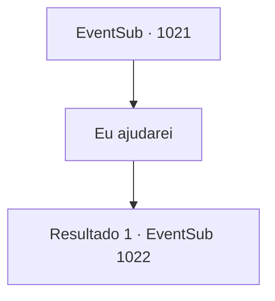

# Eventos secundários · 1021

[Índice da tabela](index.md) · [Índice geral](../index.md)

ID: `pt:EventSub:1021` · Fonte: `EventSub4` · Versão: 1.2.47.

Mapeamento estático dos arquivos; a disponibilidade e a execução dependem do estado da run.

## Texto do evento

*Sem texto no arquivo.*

## Dados de entrada

```json
{
  "id": 1021,
  "grade": 1,
  "subEvent": "",
  "required": ""
}
```

## Mapa das escolhas



## Escolhas e resultados

### Escolha 1

Eu ajudarei

Requisitos e outros campos da escolha:

```json
{
  "required": ""
}
```

#### Resultado 1.1

Você e Lupin retornam para Edward. O garoto se recuperou bem. Ele parece mais energético do que nunca. 

 "O- Oi...!"

 Edward te cumprimenta timidamente. Lupin se dirige a Edward. 

 "Devemos nos mover agora. Lukas não está mais, mas quem sabe quantos mais podem estar atrás de você, Jovem Mestre."

 Os olhos de Edward se arregalam ao ouvir a notícia. 

 "Eh...? O que você quer dizer com o Senhor Lukas está morto? Isso não pode ser..."

 Sem prestar atenção à resposta de Edward, Lupin se apressa para a partida. Você, Lupin e Edward se dirigem a 'Rouent', a cidade capital do Condado de Ronan. |drawing_Rouent| Alguns dias depois, seu grupo finalmente chega a Rouent. No topo da colina está o castelo do Conde - um ponto de vista com uma bela vista de toda Rouent. Ao se aproximarem do castelo, os guardas reconhecem imediatamente Lupin e abrem os portões. 

 "Bem-vindo de volta, Senhor Lupin."

 Lupin saúda de volta em resposta, então os conduz à sala de audiência. A porta pesada se abre. Você entra no salão espaçoso. Paredes de pedra fria cobrem a área, com um lustre de ferro pendurado no teto, emitindo uma luz tênue. No final do salão há uma fundação elevada, no topo da qual estão três cadeiras luxuosas. Sentado na cadeira central está ninguém menos que o próprio Conde Ronan. Nas duas cadeiras ao redor do Conde devem estar suas esposas. Uma parece ter a mesma idade do Conde, com cabelo branco-prateado e olhos vermelhos como rubi que te lembram Edward. A outra, com cabelo loiro encaracolado, está, a julgar pelo tamanho de sua barriga, grávida. Ela parece muito mais jovem que o Conde. Quando você, Lupin e Edward entram na câmara, você nota que os olhos dos três se arregalam. A senhora com o cabelo branco-prateado se levanta de seu assento, corre em direção a Edward, então tropeça em seu vestido, caindo. 

 "*suspiro*...! Irema!!"

 O Conde grita, assustado.

Continuação registrada: [Evento 1022](1022.md) na mesma tabela.

```json
{
  "required": "",
  "chance": "1",
  "nextEvent": 1022,
  "type": 2,
  "reward": ""
}
```

## Referências que chegam a este evento

- [Evento 1020 · escolha 1 · resultado 1](1020.md#escolha-1)
- [Evento 1020 · escolha 2 · resultado 1](1020.md#escolha-2)
