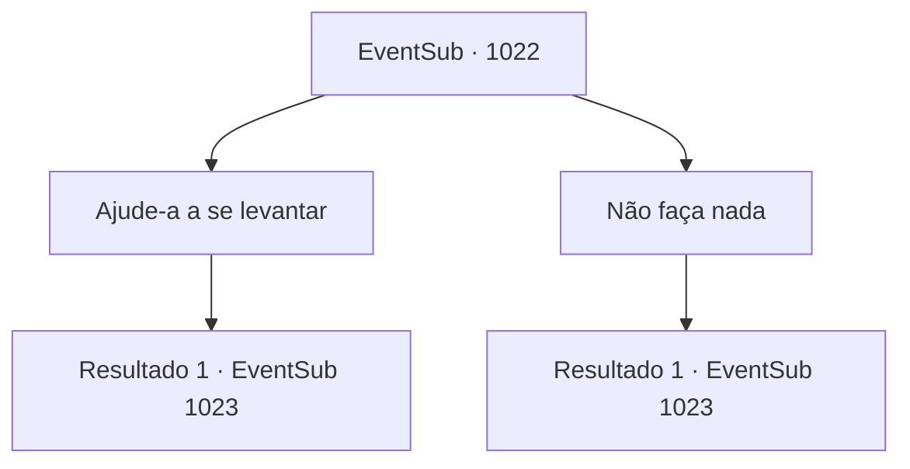

# Eventos secundários · 1022

[Índice da tabela](index.md) · [Índice geral](../index.md)

ID: `pt:EventSub:1022` · Fonte: `EventSub4` · Versão: 1.2.47.

Mapeamento estático dos arquivos; a disponibilidade e a execução dependem do estado da run.

## Texto do evento

*Sem texto no arquivo.*

## Dados de entrada

```json
{
  "id": 1022,
  "grade": 1,
  "subEvent": "",
  "required": ""
}
```

## Mapa das escolhas



## Escolhas e resultados

### Escolha 1

Ajude-a a se levantar

Requisitos e outros campos da escolha:

```json
{
  "required": ""
}
```

#### Resultado 1.1

Você imediatamente se aproxima da Condessa Irema e a ajuda a se levantar. O fato de ela ter tropeçado parece ser a menor de suas preocupações agora - segurando o vestido com as mãos, ela se dirige a Edward mais uma vez. Então, a mulher abraça o menino em um abraço amoroso. |drawing_edwardMeetAgain| O abraço de Irema dura muito tempo. Ela continua segurando o rosto de Edward em suas mãos, acariciando suas bochechas repetidamente. Rios de lágrimas escorrem de seus olhos. Nenhuma alma no mundo negaria seu relacionamento agora. Os dois não apenas compartilham uma forte semelhança familiar em suas características físicas, mas também um vínculo emocional que trouxe lágrimas a todos ao redor. O Conde se aproxima de você e Lupin. 

 "...Como diabos você conseguiu encontrar meu menino, Lupin?"

 Lupin se volta para você, para dar crédito ao seu trabalho. 

 "É tudo graças a {1} aqui, meu senhor."

 Lupin explica o papel vital que você desempenhou. O Conde Ronan segura suas mãos firmemente, chorando. 

 "Obrigado, obrigado...! Oh - onde estão meus modos... Venha, venha. Siga-me, por favor."

 O Conde pessoalmente o acompanha até o quarto de hóspedes. Ele então ordena que seus servos tragam os melhores pratos e bebidas que o pessoal do castelo pode oferecer. Você se senta em uma das cadeiras. O Conde Ronan, suas duas esposas, Lupin e Edward também se sentam. O Conde, com um sorriso caloroso, fala com você. 

 "Enquanto a comida está sendo preparada, por que você não nos conta o que aconteceu."


Continuação registrada: [Evento 1023](1023.md) na mesma tabela.

```json
{
  "required": "",
  "chance": "1",
  "nextEvent": 1023,
  "type": 2,
  "reward": ""
}
```

### Escolha 2

Não faça nada

Requisitos e outros campos da escolha:

```json
{
  "required": ""
}
```

#### Resultado 2.1

Você fica parado, observando a cena se desenrolar. Que ela tenha tropeçado parece ser a menor de suas preocupações agora. A Condessa se levanta, segurando o vestido com as mãos, e se dirige a Edward mais uma vez. Então, a mulher abraça o menino em um abraço amoroso. |drawing_edwardMeetAgain| O abraço de Irema dura muito tempo. Ela continua segurando o rosto de Edward em suas mãos, acariciando suas bochechas repetidamente. Rios de lágrimas escorrem de seus olhos. Nenhuma alma no mundo negaria seu relacionamento agora. Os dois não apenas compartilham uma forte semelhança familiar em suas características físicas, mas também um vínculo emocional que trouxe lágrimas a todos ao redor. O Conde se aproxima de você e Lupin. 

 "...Como diabos você conseguiu encontrar meu menino, Lupin?"

 Lupin se vira para você, para dar crédito ao seu trabalho. 

 "É tudo graças a {1} aqui, meu senhor."

 Lupin explica o papel vital que você desempenhou. O Conde Ronan segura suas mãos firmemente, chorando. 

 "Obrigado, obrigado...! Oh - onde estão meus modos... Venha, venha. Siga-me, por favor."

 O Conde pessoalmente o acompanha até o quarto de hóspedes. Ele então ordena que seus servos tragam os melhores pratos e bebidas que o pessoal do castelo pode oferecer. Você se senta em uma das cadeiras. O Conde Ronan, suas duas esposas, Lupin e Edward também se sentam. O Conde, com um sorriso caloroso, fala com você. 

 "Enquanto a comida está sendo preparada, por que você não nos conta o que aconteceu."


Continuação registrada: [Evento 1023](1023.md) na mesma tabela.

```json
{
  "required": "",
  "chance": "1",
  "nextEvent": 1023,
  "type": 2,
  "reward": ""
}
```

## Referências que chegam a este evento

- [Evento 1021 · escolha 1 · resultado 1](1021.md#escolha-1)
