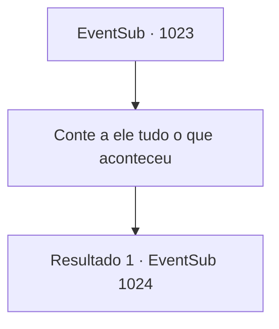

# Eventos secundários · 1023

[Índice da tabela](index.md) · [Índice geral](../index.md)

ID: `pt:EventSub:1023` · Fonte: `EventSub4` · Versão: 1.2.47.

Mapeamento estático dos arquivos; a disponibilidade e a execução dependem do estado da run.

## Texto do evento

*Sem texto no arquivo.*

## Dados de entrada

```json
{
  "id": 1023,
  "grade": 1,
  "subEvent": "",
  "required": ""
}
```

## Mapa das escolhas



## Escolhas e resultados

### Escolha 1

Conte a ele tudo o que aconteceu

Requisitos e outros campos da escolha:

```json
{
  "required": ""
}
```

#### Resultado 1.1

Você conta toda a história ao Conde. Aproximadamente na metade da sua explicação, o rosto do Conde Ronan fica vermelho de raiva. Ele começa a ranger os dentes, tão forte que você pode ouvir o barulho. 

 "Lukas...? AQUELE Lukas...??!"

 Enquanto o Conde murmura para si mesmo com raiva, Irema Ronan desmaia. 

 "C- CONDESSA!"

 Ronan e Lupin ajudam apressadamente a Condessa a sair do quarto de hóspedes. Os criados escoltam Edward de volta ao seu quarto também. A outra esposa do Conde observa silenciosamente a cena se desenrolar. Ela está apenas sentada ali na sua cadeira. Algo parece estar preocupando-a.

Continuação registrada: [Evento 1024](1024.md) na mesma tabela.

```json
{
  "required": "",
  "chance": "1",
  "nextEvent": 1024,
  "type": 2,
  "reward": ""
}
```

## Referências que chegam a este evento

- [Evento 1022 · escolha 1 · resultado 1](1022.md#escolha-1)
- [Evento 1022 · escolha 2 · resultado 1](1022.md#escolha-2)
