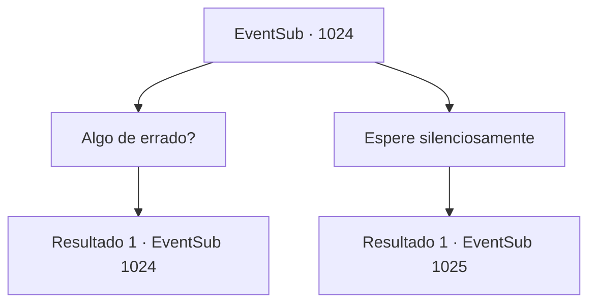

# Eventos secundários · 1024

[Índice da tabela](index.md) · [Índice geral](../index.md)

ID: `pt:EventSub:1024` · Fonte: `EventSub4` · Versão: 1.2.47.

Mapeamento estático dos arquivos; a disponibilidade e a execução dependem do estado da run.

## Texto do evento

*Sem texto no arquivo.*

## Dados de entrada

```json
{
  "id": 1024,
  "grade": 1,
  "subEvent": "",
  "required": ""
}
```

## Mapa das escolhas



## Escolhas e resultados

### Escolha 1

Algo de errado?

Requisitos e outros campos da escolha:

```json
{
  "required": "8_365_1|5_801_0"
}
```

#### Resultado 1.1

A mulher responde olhando para você de forma maliciosa. 

 "O que você quer dizer?"

 Você tira a carta que encontrou do seu bolso. A tez de Hazel fica pálida imediatamente. 

 "I- isso é...! DEVOLVA ISSO AGORA MESMO!"

 Ela tenta pegar a carta, mas você facilmente evita seu alcance. Hazel começa a ranger os dentes também, então continua. 

 "...Julgando pelo fato de que você escolheu me mostrar essa carta em vez de mostrar ao próprio Conde, presumo que você esteja aberto a negociações? ... Conversaremos mais tarde."

 Ela diz para você esperá-la em uma pequena estalagem chamada 'Noite Estrelada Azul', localizada logo fora das muralhas do castelo.

Continuação registrada: [Evento 1024](1024.md) na mesma tabela.

```json
{
  "required": "",
  "chance": "1",
  "nextEvent": 1024,
  "type": 2,
  "reward": "5_801_1"
}
```

### Escolha 2

Espere silenciosamente

Requisitos e outros campos da escolha:

```json
{
  "required": ""
}
```

#### Resultado 2.1

O tempo passa em um silêncio constrangedor. Logo, o Conde retorna à sala. 

 "Agradeço novamente, {1}. Minha Casa não é exatamente conhecida por suas riquezas, mas temos raízes que remontam a uma linhagem de um grande guerreiro. História de orgulho, eu diria."

 Ele continua, mostrando a você a relíquia de família. 

 "Aqui - uma lança ancestral, passada por gerações. Ah, e se você não quiser a lança, ficarei feliz em pagar-lhe com ouro, do meu acervo pessoal."


Continuação registrada: [Evento 1025](1025.md) na mesma tabela.

```json
{
  "required": "",
  "chance": "1",
  "nextEvent": 1025,
  "type": 2,
  "reward": ""
}
```

## Referências que chegam a este evento

- [Evento 1023 · escolha 1 · resultado 1](1023.md#escolha-1)
- [Evento 1024 · escolha 1 · resultado 1](1024.md#escolha-1)
- [Evento 1030 · escolha 1 · resultado 1](1030.md#escolha-1)
- [Evento 1030 · escolha 1 · resultado 3](1030.md#escolha-1)
- [Evento 1030 · escolha 2 · resultado 1](1030.md#escolha-2)
- [Evento 1041 · escolha 3 · resultado 1](1041.md#escolha-3)
