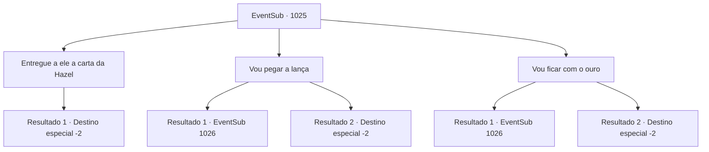

# Eventos secundários · 1025

[Índice da tabela](index.md) · [Índice geral](../index.md)

ID: `pt:EventSub:1025` · Fonte: `EventSub4` · Versão: 1.2.47.

Mapeamento estático dos arquivos; a disponibilidade e a execução dependem do estado da run.

## Texto do evento

*Sem texto no arquivo.*

## Dados de entrada

```json
{
  "id": 1025,
  "grade": 1,
  "subEvent": "",
  "required": ""
}
```

## Mapa das escolhas



## Escolhas e resultados

### Escolha 1

Entregue a ele a carta da Hazel

Requisitos e outros campos da escolha:

```json
{
  "required": "8_365_1"
}
```

#### Resultado 1.1

Você tira a carta de Hazel. O Conde responde com um olhar confuso. Quanto a Hazel, ela já está ficando pálida. 

 "O que é isso?"

 O Conde Ronan leva um minuto para ler a carta. Seu rosto fica vermelho de raiva. Até suas mãos estão tremendo. 

 "... SOLDADOS! PRENDAM HAZEL, IMEDIATAMENTE!"

 Todos na sala ficam surpresos ao ouvir isso. Os soldados hesitam a princípio em sequer tocar no corpo da segunda esposa. Mas Ronan insiste, até desembainhando sua própria espada. 

 "EU GAGUEJEI?! PRENDAM ESSA BRUXA, AGORA MESMO!"

 Hazel implora inocência, seus olhos arregalados de medo, mas Ronan parece não ter intenção de ouvi-la. Infelizmente, Hazel é arrastada para longe. O Conde solta um longo suspiro e se senta novamente em seu assento. 

 "*suspiro*... O que é tudo isso...?"

 Ele enxuga o suor do rosto e tenta se acalmar. O Conde se volta para você e continua. 

 "Você não precisava ver isso. Peço desculpas. Sabe de uma coisa? Leve a lança e o ouro também. Você conseguiu extirpar uma infecção de nossa Casa. Você nos salvou a todos."

 Após receber suas recompensas, você deixa a sala de audiência.

Continuação registrada: [Destino especial `-2`](../destinos-especiais.md).

```json
{
  "required": "",
  "chance": "1",
  "nextEvent": -2,
  "type": 2,
  "reward": "3_367_1|0_4_200|12_12_-1|14_12_1|14_12_3"
}
```

### Escolha 2

Vou pegar a lança

Requisitos e outros campos da escolha:

```json
{
  "required": ""
}
```

#### Resultado 2.1

Você diz a ele que ficará com a lança ancestral. Ronan sorri feliz, entregando-lhe a arma de herança. 

 "Faça bom uso dela. E obrigado novamente por salvar Edward."

 Ele pessoalmente o acompanha para fora do castelo. Você deixa os terrenos do castelo e segue para a estalagem 'Noite Estrelada Azul'. Lá, você espera Hazel chegar. 

 "Você deve ser {1}. Correto?"

 Um homem com uma espada larga o cumprimenta. Ele se apresenta como o arauto de Hazel e oferece uma troca - Hazel lhe pagará 200 moedas de ouro, e você ficará de boca fechada sobre o segredo dela.

Continuação registrada: [Evento 1026](1026.md) na mesma tabela.

```json
{
  "required": "5_801_1",
  "chance": "1",
  "nextEvent": 1026,
  "type": 2,
  "reward": "3_367_1"
}
```

#### Resultado 2.2

Você diz a ele que ficará com a lança ancestral. Ronan sorri feliz, entregando-lhe a arma de herança. 

 "Faça bom uso dela. E obrigado novamente por salvar Edward."

 Ele pessoalmente o acompanha para fora do castelo.

Continuação registrada: [Destino especial `-2`](../destinos-especiais.md).

```json
{
  "required": "18_801_1",
  "chance": "1",
  "nextEvent": -2,
  "type": 2,
  "reward": "3_367_1|12_12_-1|14_12_1|14_12_7"
}
```

### Escolha 3

Vou ficar com o ouro

Requisitos e outros campos da escolha:

```json
{
  "required": ""
}
```

#### Resultado 3.1

Você diz a ele que ficará com o ouro. Ronan sorri feliz, entregando-lhe um baú cheio de ouro. 

 "Faça bom uso disso. E obrigado novamente por salvar Edward."

 Ele pessoalmente o escolta para fora do castelo. Você deixa os terrenos do castelo e segue para a estalagem 'Noite Azul Estrelada'. Lá, você espera Hazel chegar. 

 "Você deve ser {1}. Correto?"

 Um homem com uma grande espada o cumprimenta. Ele se apresenta como o arauto de Hazel e oferece uma troca - Hazel lhe pagará 200 ouro, e você ficará de boca fechada sobre o segredo dela.

Continuação registrada: [Evento 1026](1026.md) na mesma tabela.

```json
{
  "required": "5_801_1",
  "chance": "1",
  "nextEvent": 1026,
  "type": 2,
  "reward": "0_4_200"
}
```

#### Resultado 3.2

Você diz a ele que ficará com o ouro. Ronan sorri feliz, entregando-lhe um baú cheio de ouro. 

 "Faça bom uso disso. E obrigado novamente por salvar Edward."

 Ele pessoalmente o acompanha para fora do castelo.

Continuação registrada: [Destino especial `-2`](../destinos-especiais.md).

```json
{
  "required": "18_801_1",
  "chance": "1",
  "nextEvent": -2,
  "type": 2,
  "reward": "0_4_200|12_12_-1|14_12_1|14_12_7"
}
```

## Referências que chegam a este evento

- [Evento 1024 · escolha 2 · resultado 1](1024.md#escolha-2)
