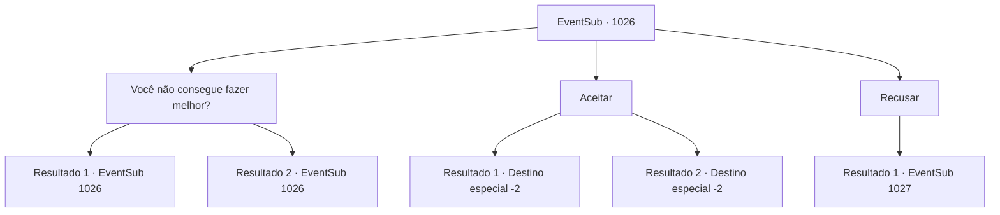

# Eventos secundários · 1026

[Índice da tabela](index.md) · [Índice geral](../index.md)

ID: `pt:EventSub:1026` · Fonte: `EventSub4` · Versão: 1.2.47.

Mapeamento estático dos arquivos; a disponibilidade e a execução dependem do estado da run.

## Texto do evento

*Sem texto no arquivo.*

## Dados de entrada

```json
{
  "id": 1026,
  "grade": 1,
  "subEvent": "",
  "required": ""
}
```

## Mapa das escolhas



## Escolhas e resultados

### Escolha 1

Você não consegue fazer melhor?

Requisitos e outros campos da escolha:

```json
{
  "required": "5_802_0"
}
```

#### Resultado 1.1

Você recusa a oferta, exigindo que ele aumente o pagamento. Ele fica em silêncio por um tempo, então continua. 

 "300 ouro, então. Oferta final."


Continuação registrada: [Evento 1026](1026.md) na mesma tabela.

```json
{
  "required": "",
  "chance": "1|0_12_1",
  "nextEvent": 1026,
  "type": 0,
  "reward": "5_802_1"
}
```

#### Resultado 1.2

Você recusa a oferta, exigindo que ele aumente o pagamento. Ele fica em silêncio por um tempo, depois balança a cabeça. 

 "200 ouro. Oferta final."


Continuação registrada: [Evento 1026](1026.md) na mesma tabela.

```json
{
  "required": "",
  "chance": "20",
  "nextEvent": 1026,
  "type": 1,
  "reward": "5_802_2"
}
```

### Escolha 2

Aceitar

Requisitos e outros campos da escolha:

```json
{
  "required": ""
}
```

#### Resultado 2.1

Você aceita a oferta, entregando ao homem a carta de Hazel. Depois de prometer manter o segredo de Hazel em segredo, o homem lhe entrega uma bolsa cheia de ouro. 

 "Uma escolha sábia. Vou indo, então."

 O homem com a espada larga se despede de você e sai da estalagem.

Continuação registrada: [Destino especial `-2`](../destinos-especiais.md).

```json
{
  "required": "5_802_1",
  "chance": "1",
  "nextEvent": -2,
  "type": 2,
  "reward": "12_12_-1|0_4_300|14_12_1|14_12_7|4_365_1"
}
```

#### Resultado 2.2

Você aceita a oferta, entregando ao homem a carta de Hazel. Depois de prometer manter o segredo de Hazel em segredo, o homem lhe entrega uma bolsa cheia de ouro. 

 "Uma escolha sábia. Vou indo, então."

 O homem com a espada larga se despede de você e sai da estalagem.

Continuação registrada: [Destino especial `-2`](../destinos-especiais.md).

```json
{
  "required": "18_802_1",
  "chance": "1",
  "nextEvent": -2,
  "type": 2,
  "reward": "12_12_-1|0_4_200|14_12_1|14_12_7|4_365_1"
}
```

### Escolha 3

Recusar

Requisitos e outros campos da escolha:

```json
{
  "required": ""
}
```

#### Resultado 3.1

Você recusa a oferta. O homem responde avançando contra você com sua espada larga.

Continuação registrada: [Evento 1027](1027.md) na mesma tabela.

```json
{
  "required": "",
  "chance": "1",
  "nextEvent": 1027,
  "type": 2,
  "reward": "6_4_185",
  "place": 4
}
```

## Referências que chegam a este evento

- [Evento 1025 · escolha 2 · resultado 1](1025.md#escolha-2)
- [Evento 1025 · escolha 3 · resultado 1](1025.md#escolha-3)
- [Evento 1026 · escolha 1 · resultado 1](1026.md#escolha-1)
- [Evento 1026 · escolha 1 · resultado 2](1026.md#escolha-1)
