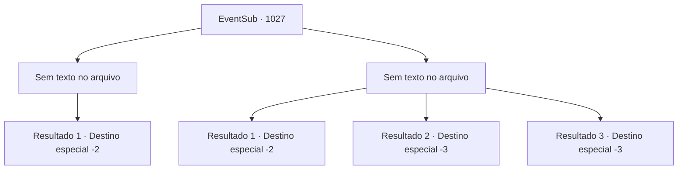

# Eventos secundários · 1027

[Índice da tabela](index.md) · [Índice geral](../index.md)

ID: `pt:EventSub:1027` · Fonte: `EventSub4` · Versão: 1.2.47.

Mapeamento estático dos arquivos; a disponibilidade e a execução dependem do estado da run.

## Texto do evento

*Sem texto no arquivo.*

## Dados de entrada

```json
{
  "id": 1027,
  "grade": 1,
  "subEvent": "",
  "required": ""
}
```

## Mapa das escolhas



## Escolhas e resultados

### Escolha 1

*Sem texto no arquivo; o papel dessa opção depende da interface do jogo.*

Requisitos e outros campos da escolha:

```json
{
  "required": ""
}
```

#### Resultado 1.1

Ele não é páreo para você. Seu corpo sem vida desaba no chão. A espada larga jaz ao lado do cadáver de seu dono também. 

 "Tsc...! Isso... não pode ser...!"

 Você pega a espada larga e o ouro, depois sai da estalagem. Imediatamente, você volta para o castelo do Conde. Ronan e Irema estão conversando com Edward na sala de audiências - eles parecem surpresos ao vê-lo novamente tão cedo. Hazel, em pé ao lado deles, fica pálida. 

 "Hm? Esqueceu algo?"

 Você responde ao Conde entregando-lhe a carta de Hazel. Ele pega a carta com um toque de suspeita, começa a ler, e logo a suspeita se transforma em raiva. 

 "... SOLDADOS! PRENDAM HAZEL, IMEDIATAMENTE!"

 Todos na sala ficam espantados ao ouvir isso. Os soldados hesitam a princípio em sequer tocar no corpo da segunda esposa. Mas Ronan insiste, até desembainhando sua própria espada. 

 "EU GAGUEJEI?! PRENDAM ESSA BRUXA, AGORA MESMO!"

 Hazel alega inocência, seus olhos arregalados de medo, mas Ronan parece não ter intenção de ouvi-la. Infelizmente, Hazel é arrastada para longe. O Conde solta um longo suspiro e se senta novamente em seu assento. 

 "*suspiro*... O que é tudo isso...?"

 Ele enxuga o suor do rosto e tenta se acalmar. O Conde se volta para você e continua. 

 "Você conseguiu extirpar uma infecção de nossa Casa. Você nos salvou a todos. Agradeço por nos informar."

 Você se despede do Conde e de sua família uma última vez, depois sai da sala de audiências.

Continuação registrada: [Destino especial `-2`](../destinos-especiais.md).

```json
{
  "required": "",
  "chance": "1",
  "nextEvent": -2,
  "type": 2,
  "reward": "12_12_-1|14_12_1|14_12_3|3_67_1|0_4_200"
}
```

### Escolha 2

*Sem texto no arquivo; o papel dessa opção depende da interface do jogo.*

Requisitos e outros campos da escolha:

```json
{
  "required": ""
}
```

#### Resultado 2.1

O homem com a espada larga ataca você violentamente, jogando-o no chão. Em meio à visão turva, você percebe que ele se aproxima para dar o golpe final. Então, você ouve passos - provavelmente os guardas da cidade. Seu oponente hesita por um momento. Em vez de acabar com você, ele pega a carta de Hazel de suas mãos e foge.

Continuação registrada: [Destino especial `-2`](../destinos-especiais.md).

```json
{
  "required": "1_0_2|1_1_2",
  "chance": "1",
  "nextEvent": -2,
  "type": 2,
  "reward": "12_12_-1|0_0_-1|0_1_-1|14_12_1|14_12_7|4_365_1"
}
```

#### Resultado 2.2

A grande espada dele corta seu crânio, partindo seu corpo em dois.

Continuação registrada: [Destino especial `-3`](../destinos-especiais.md).

```json
{
  "required": "2_0_2",
  "chance": "1",
  "nextEvent": -3,
  "type": 2,
  "reward": "0_0_-1|0_1_-1"
}
```

#### Resultado 2.3

A grande espada dele corta seu crânio, partindo seu corpo em dois.

Continuação registrada: [Destino especial `-3`](../destinos-especiais.md).

```json
{
  "required": "2_1_2",
  "chance": "1",
  "nextEvent": -3,
  "type": 2,
  "reward": "0_0_-1|0_1_-1"
}
```

## Referências que chegam a este evento

- [Evento 1026 · escolha 3 · resultado 1](1026.md#escolha-3)
