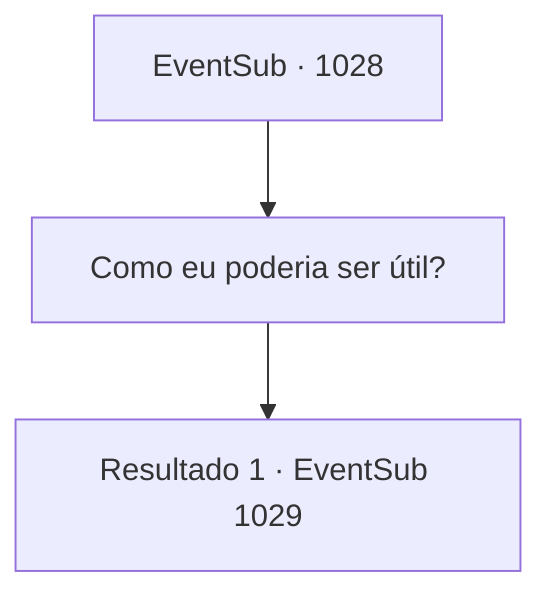

# Eventos secundários · 1028

[Índice da tabela](index.md) · [Índice geral](../index.md)

ID: `pt:EventSub:1028` · Fonte: `EventSub4` · Versão: 1.2.47.

Mapeamento estático dos arquivos; a disponibilidade e a execução dependem do estado da run.

## Texto do evento

|drawing_Rouent| Após alguns dias de viagem, você chega à cidade capital do Condado de Ronan, 'Rouent'. No topo da colina está o castelo do Conde - um ponto de vista com uma bela vista de toda Rouent. Ao se aproximar dos portões do castelo, um dos guardas se aproxima de você. 

 "Ah. {1}, certo? O Conde está procurando por você. Por favor, permita-me escoltá-lo."

 Você é guiado pelo guarda até a sala de audiência, onde o Conde está esperando. 

 A pesada porta se abre. Você entra no salão espaçoso. Paredes de pedra fria cobrem a área, com um lustre de ferro pendurado no teto, emitindo uma luz tênue. No final do salão há uma fundação elevada, sobre a qual estão três cadeiras luxuosas. Sentado na cadeira do centro está ninguém menos que o próprio Conde Ronan. Nas duas cadeiras ao redor do Conde devem estar suas esposas. Uma parece ter a mesma idade do Conde, com cabelos branco-prateados e olhos vermelhos como rubi que lembram você de Edward. A outra, com cabelos loiros e encaracolados, está, a julgar pelo tamanho de sua barriga, grávida. Ela parece muito mais jovem que o Conde. Então, o olhar do Conde se volta para você. 

 "Você deve ser {1}. Que sorte - eu estava procurando por você, na verdade."


## Dados de entrada

```json
{
  "id": 1028,
  "grade": 1,
  "subEvent": "",
  "required": "12_12_6"
}
```

## Mapa das escolhas



## Escolhas e resultados

### Escolha 1

Como eu poderia ser útil?

Requisitos e outros campos da escolha:

```json
{
  "required": ""
}
```

#### Resultado 1.1

Você se aproxima do Conde para prestar respeitos. O Conde começa agradecendo a você. 

 "Agradeço por trazer meu filho de volta para mim. Mas... há um problema."

 Ele lhe diz que Edward está inconsciente há muito tempo. Ele acredita que você é a única pessoa capaz de resolver esse problema. 

 "Por favor - encontre uma maneira de libertar meu filho dessa maldição."


Continuação registrada: [Evento 1029](1029.md) na mesma tabela.

```json
{
  "required": "",
  "chance": "1",
  "nextEvent": 1029,
  "type": 2,
  "reward": ""
}
```

## Referências que chegam a este evento

Nenhum `nextEvent` positivo da mesma tabela aponta para este nó. Isso não prova que seja inacessível: sorteio e estado de história podem selecioná-lo.

