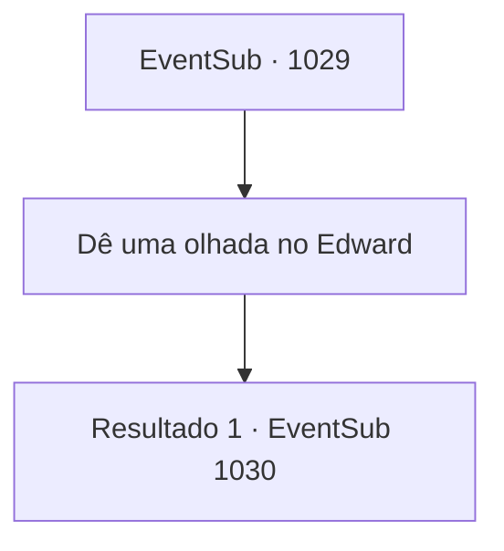

# Eventos secundários · 1029

[Índice da tabela](index.md) · [Índice geral](../index.md)

ID: `pt:EventSub:1029` · Fonte: `EventSub4` · Versão: 1.2.47.

Mapeamento estático dos arquivos; a disponibilidade e a execução dependem do estado da run.

## Texto do evento

*Sem texto no arquivo.*

## Dados de entrada

```json
{
  "id": 1029,
  "grade": 1,
  "subEvent": "",
  "required": ""
}
```

## Mapa das escolhas



## Escolhas e resultados

### Escolha 1

Dê uma olhada no Edward

Requisitos e outros campos da escolha:

```json
{
  "required": ""
}
```

#### Resultado 1.1

Você segue o Conde até o quarto de Edward. 

 "Aqui. Sinta-se à vontade para dar uma olhada mais de perto."

 O quarto de Edward é bastante simples, considerando que ele é filho do Conde. Não há muitos móveis ou decorações - mas uma cama de artesanato requintado. Naquela cama está Edward. Você olha em seus olhos, mas o garoto não responde de forma alguma. De repente, com um espasmo violento, Edward começa a fazer ruídos estranhos e guturais. Então ele cai de volta na cama e dorme profundamente como se nada tivesse acontecido. Lupin observa isso e fala. 

 "Acho que Lukas estava certo sobre a maldição. O Jovem Mestre ainda a tem dentro de si."


Continuação registrada: [Evento 1030](1030.md) na mesma tabela.

```json
{
  "required": "",
  "chance": "1",
  "nextEvent": 1030,
  "type": 2,
  "reward": ""
}
```

## Referências que chegam a este evento

- [Evento 1028 · escolha 1 · resultado 1](1028.md#escolha-1)
