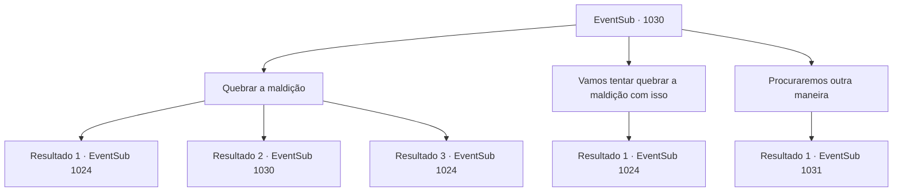

# Eventos secundários · 1030

[Índice da tabela](index.md) · [Índice geral](../index.md)

ID: `pt:EventSub:1030` · Fonte: `EventSub4` · Versão: 1.2.47.

Mapeamento estático dos arquivos; a disponibilidade e a execução dependem do estado da run.

## Texto do evento

*Sem texto no arquivo.*

## Dados de entrada

```json
{
  "id": 1030,
  "grade": 1,
  "subEvent": "",
  "required": ""
}
```

## Mapa das escolhas



## Escolhas e resultados

### Escolha 1

Quebrar a maldição

Requisitos e outros campos da escolha:

```json
{
  "required": "5_803_0"
}
```

#### Resultado 1.1

Edward está aflito com várias camadas de maldições. Mas com grande concentração, você consegue desfazê-las, uma por uma. Após horas de operação, você finalmente se livra de todas as maldições colocadas por Lukas. Você está encharcado de suor, com o cansaço tomando conta. O Conde e a Condessa, depois de assistir a todo o processo com preocupação, finalmente soltam suspiros de alívio. 

 "O- onde estou?"

 Edward finalmente fala. A Condessa de cabelos brancos cai em lágrimas e abraça o menino. 

 "Ed...! MEU FILHO...!!"

 Ela parece ter esquecido sua posição como Condessa. Sua maquiagem está toda borrada pelas lágrimas, abraçando seu filho com força. Edward parece confuso com tudo, mas ainda assim retribui o abraço da mãe. O Conde se junta, com os olhos marejados. Logo, ele percebe sua presença novamente e recupera a compostura. 

 "Ahem... Se nos der licença por um segundo."

 Ele sai com a Condessa e Edward, escoltando-os para outra sala. A outra esposa do Conde observa a cena em silêncio. Algo parece estar preocupando-a.

Continuação registrada: [Evento 1024](1024.md) na mesma tabela.

```json
{
  "required": "21_0_4",
  "chance": "1|0_7_1|0_12_1",
  "nextEvent": 1024,
  "type": 0,
  "reward": "5_803_1"
}
```

#### Resultado 1.2

Você tenta desfazer as maldições que Lukas colocou em Edward, sem sucesso. Edward está deitado na cama, sua expressão vazia. Ronan e Irema soltam longos suspiros. 

 "Talvez haja outra maneira."


Continuação registrada: [Evento 1030](1030.md) na mesma tabela.

```json
{
  "required": "21_0_4",
  "chance": "40",
  "nextEvent": 1030,
  "type": 1,
  "reward": "5_803_9"
}
```

#### Resultado 1.3

Edward está aflito com várias camadas de maldições. Mas com grande concentração, você consegue desfazê-las, uma por uma. Após horas de operação, você finalmente se livra de todas as maldições colocadas por Lukas. Você está encharcado de suor, com o cansaço tomando conta. O Conde e a Condessa, depois de assistir a todo o processo com preocupação, finalmente soltam suspiros de alívio. 

 "O- onde estou?"

 Edward finalmente fala. A Condessa de cabelos brancos cai em lágrimas e abraça o menino. 

 "Ed...! MEU FILHO...!!"

 Ela parece ter esquecido sua posição como Condessa. Sua maquiagem está toda borrada pelas lágrimas, abraçando seu filho com força. Edward parece confuso com tudo, mas ainda assim retribui o abraço da mãe. O Conde se junta, com os olhos marejados. Logo, ele percebe sua presença novamente e recupera a compostura. 

 "Ahem... Se nos der licença por um segundo."

 Ele sai com a Condessa e Edward, escoltando-os para outra sala. A outra esposa do Conde observa a cena em silêncio. Algo parece estar preocupando-a.

Continuação registrada: [Evento 1024](1024.md) na mesma tabela.

```json
{
  "required": "20_0_4",
  "chance": "1",
  "nextEvent": 1024,
  "type": 2,
  "reward": "5_803_1"
}
```

### Escolha 2

Vamos tentar quebrar a maldição com isso

Requisitos e outros campos da escolha:

```json
{
  "required": "23_9_1"
}
```

#### Resultado 2.1

Com a ajuda de um item, você começa a desfazer as maldições uma por uma. Os olhos de Edward voltam ao normal novamente, como se ele tivesse acabado de acordar de um longo sonho. 

 "O- onde estou?"

 Edward finalmente fala. A condessa de cabelos brancos cai em lágrimas e abraça o menino. 

 "Ed...! MEU FILHO... !!"

 Ela parece ter esquecido sua posição como condessa. Sua maquiagem está toda borrada pelas lágrimas, abraçando seu filho com força. Edward parece confuso com tudo, mas ainda assim retribui o abraço da mãe. O conde se junta, com os olhos marejados. Logo, ele percebe sua presença novamente e recupera a compostura. 

 "Ahem... Se nos der licença por um momento."

 Ele sai com a condessa e Edward, escoltando-os para outra sala. A outra esposa do conde observa a cena em silêncio. Algo parece estar preocupando-a.

Continuação registrada: [Evento 1024](1024.md) na mesma tabela.

```json
{
  "required": "",
  "chance": "1",
  "nextEvent": 1024,
  "type": 2,
  "reward": "5_803_1"
}
```

### Escolha 3

Procuraremos outra maneira

Requisitos e outros campos da escolha:

```json
{
  "required": ""
}
```

#### Resultado 3.1

Você decide procurar outro caminho e deixar a câmara de audiência. Lupin se aproxima para conversar. 

 "Lukas, aquele vilão. Um pé no saco mesmo depois de morto. Isso é algo que eu poderia ter evitado... Deixe-me acompanhá-lo. Acho que pode haver algo deixado para trás nas Catacumbas."


Continuação registrada: [Evento 1031](1031.md) na mesma tabela.

```json
{
  "required": "",
  "chance": "1",
  "nextEvent": 1031,
  "type": 2,
  "reward": ""
}
```

## Referências que chegam a este evento

- [Evento 1029 · escolha 1 · resultado 1](1029.md#escolha-1)
- [Evento 1030 · escolha 1 · resultado 2](1030.md#escolha-1)
