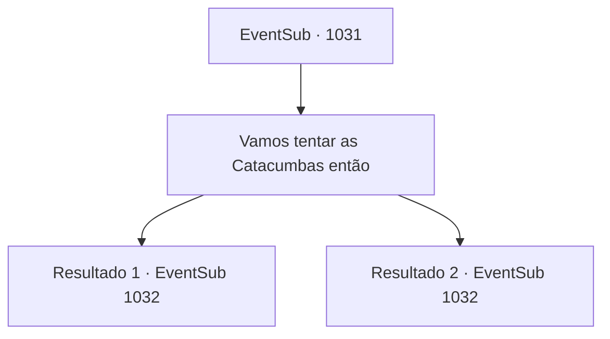

# Eventos secundários · 1031

[Índice da tabela](index.md) · [Índice geral](../index.md)

ID: `pt:EventSub:1031` · Fonte: `EventSub4` · Versão: 1.2.47.

Mapeamento estático dos arquivos; a disponibilidade e a execução dependem do estado da run.

## Texto do evento

*Sem texto no arquivo.*

## Dados de entrada

```json
{
  "id": 1031,
  "grade": 1,
  "subEvent": "",
  "required": ""
}
```

## Mapa das escolhas



## Escolhas e resultados

### Escolha 1

Vamos tentar as Catacumbas então

Requisitos e outros campos da escolha:

```json
{
  "required": ""
}
```

#### Resultado 1.1

Você e Lupin retornam às Catacumbas, onde Lukas estava se escondendo. Vocês dois entram e começam a investigar os rastros deixados por Lukas. No chão, encontram velas apagadas e pergaminhos rasgados. Sangue está espalhado pelas paredes, com um sigilo de aparência antiga ainda emitindo um leve brilho. 

 "Oh... Tem algo aqui. Tente este."

 Lupin retorna para você com um pedaço de pergaminho que encontrou em algum lugar. Parece ser algum tipo de documento, escrito com sangue negro.

Continuação registrada: [Evento 1032](1032.md) na mesma tabela.

```json
{
  "required": "18_797_1",
  "chance": "1",
  "nextEvent": 1032,
  "type": 2,
  "reward": ""
}
```

#### Resultado 1.2

Você e Lupin retornam às Catacumbas, onde Lukas estava se escondendo. Vocês dois entram e começam a investigar os rastros deixados por Lukas. Devido ao impacto da batalha anterior, o teto ainda está destruído, mas alguém deve ter limpado os destroços e o cadáver de Lukas. No chão, vocês encontram velas apagadas e pergaminhos rasgados. Sangue está espalhado pelas paredes, com um sigilo de aparência antiga ainda emitindo um brilho fraco. 

 "Oh... Tem algo aqui. Experimente este."

 Lupin retorna para você com um pedaço de pergaminho que encontrou em algum lugar. Parece ser algum tipo de documento, escrito com sangue negro.

Continuação registrada: [Evento 1032](1032.md) na mesma tabela.

```json
{
  "required": "5_797_1",
  "chance": "1",
  "nextEvent": 1032,
  "type": 2,
  "reward": ""
}
```

## Referências que chegam a este evento

- [Evento 1030 · escolha 3 · resultado 1](1030.md#escolha-3)
