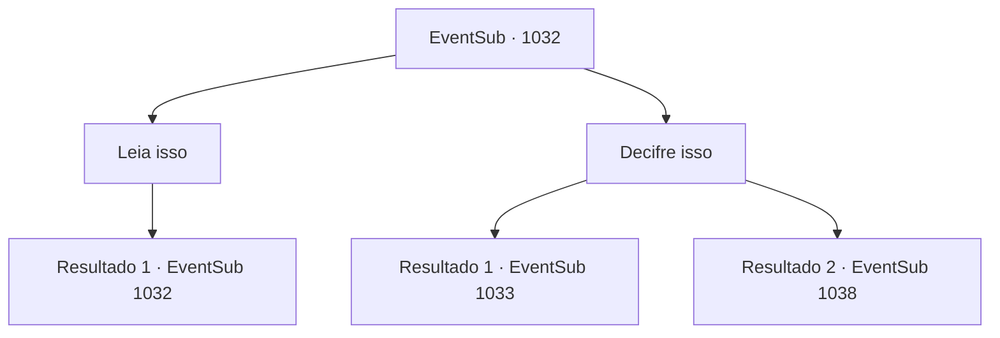

# Eventos secundários · 1032

[Índice da tabela](index.md) · [Índice geral](../index.md)

ID: `pt:EventSub:1032` · Fonte: `EventSub4` · Versão: 1.2.47.

Mapeamento estático dos arquivos; a disponibilidade e a execução dependem do estado da run.

## Texto do evento

*Sem texto no arquivo.*

## Dados de entrada

```json
{
  "id": 1032,
  "grade": 1,
  "subEvent": "",
  "required": ""
}
```

## Mapa das escolhas



## Escolhas e resultados

### Escolha 1

Leia isso

Requisitos e outros campos da escolha:

```json
{
  "required": "5_804_0"
}
```

#### Resultado 1.1

Lupin encara o documento por um tempo. Ele geme dolorosamente por um tempo, inspecionando o pergaminho, mas logo o devolve para você. 

 "Eu... não faço ideia do que está escrito. Quem escreveu isso tem uma caligrafia terrível."


Continuação registrada: [Evento 1032](1032.md) na mesma tabela.

```json
{
  "required": "",
  "chance": "1",
  "nextEvent": 1032,
  "type": 2,
  "reward": "5_804_1"
}
```

### Escolha 2

Decifre isso

Requisitos e outros campos da escolha:

```json
{
  "required": ""
}
```

#### Resultado 2.1

Você decifra o documento com facilidade. Escrito no pergaminho está um registro detalhado do ritual de maldição de Lukas. 'Desenhe um círculo com pó de ossos fino. Desenhe um diamante que inscreva o círculo com sangue. Começando do norte, no sentido anti-horário, coloque um crânio, perna dianteira de uma cabra, perna de uma aranha gigante e um rabo de manticora. Para desfazer a maldição, repita o ritual ao contrário.' Enquanto você lê o documento, Lupin está ocupado reunindo os ingredientes do ritual. 

 "Hm... Um pouco dessecado, mas ainda utilizável. Lukas deve ter preparado um excedente. Mas quanto ao rabo de manticora... Teremos que encontrar um novo."

 Lupin murmura, cuidadosamente sacudindo o rabo de manticora quebrado com o pé.

Continuação registrada: [Evento 1033](1033.md) na mesma tabela.

```json
{
  "required": "",
  "chance": "1|0_7_1",
  "nextEvent": 1033,
  "type": 0,
  "reward": ""
}
```

#### Resultado 2.2

Você tenta decifrar o documento, sem sucesso. Lupin considera suas opções, então fala. 

 "Talvez possamos encontrar alguém para decifrar o documento para nós? Um ancião da cidade, um padre... Nós dois não faremos muito progresso sozinhos. Vamos sair daqui primeiro."


Continuação registrada: [Evento 1038](1038.md) na mesma tabela.

```json
{
  "required": "",
  "chance": "10",
  "nextEvent": 1038,
  "type": 1,
  "reward": ""
}
```

## Referências que chegam a este evento

- [Evento 1031 · escolha 1 · resultado 1](1031.md#escolha-1)
- [Evento 1031 · escolha 1 · resultado 2](1031.md#escolha-1)
- [Evento 1032 · escolha 1 · resultado 1](1032.md#escolha-1)
