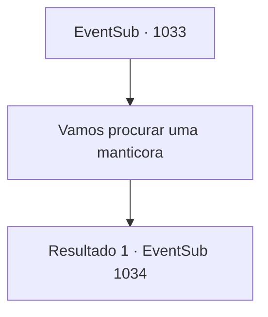

# Eventos secundários · 1033

[Índice da tabela](index.md) · [Índice geral](../index.md)

ID: `pt:EventSub:1033` · Fonte: `EventSub4` · Versão: 1.2.47.

Mapeamento estático dos arquivos; a disponibilidade e a execução dependem do estado da run.

## Texto do evento

*Sem texto no arquivo.*

## Dados de entrada

```json
{
  "id": 1033,
  "grade": 1,
  "subEvent": "",
  "required": ""
}
```

## Mapa das escolhas



## Escolhas e resultados

### Escolha 1

Vamos procurar uma manticora

Requisitos e outros campos da escolha:

```json
{
  "required": ""
}
```

#### Resultado 1.1

Lupin responde à sua sugestão. 

 "Boa ideia. Vou perguntar aos locais. Você deveria fazer o mesmo. Vamos nos encontrar aqui novamente mais tarde."

 Você e Lupin saem das Catacumbas para coletar informações individualmente.

Continuação registrada: [Evento 1034](1034.md) na mesma tabela.

```json
{
  "required": "",
  "chance": "1",
  "nextEvent": 1034,
  "type": 2,
  "reward": ""
}
```

## Referências que chegam a este evento

- [Evento 1032 · escolha 2 · resultado 1](1032.md#escolha-2)
- [Evento 1038 · escolha 1 · resultado 1](1038.md#escolha-1)
