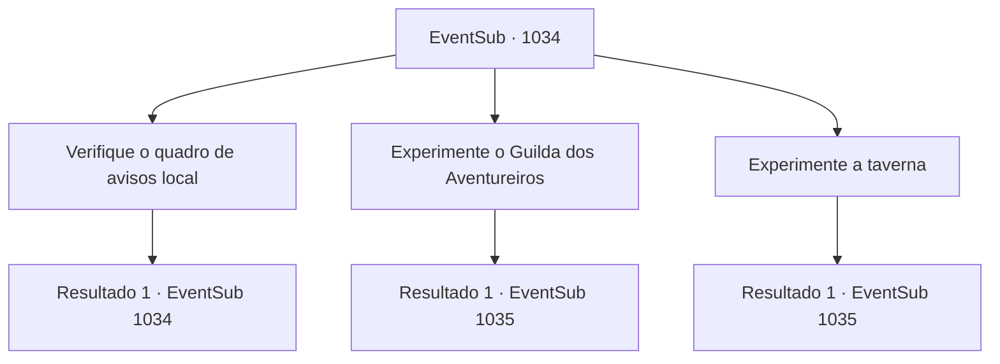

# Eventos secundários · 1034

[Índice da tabela](index.md) · [Índice geral](../index.md)

ID: `pt:EventSub:1034` · Fonte: `EventSub4` · Versão: 1.2.47.

Mapeamento estático dos arquivos; a disponibilidade e a execução dependem do estado da run.

## Texto do evento

*Sem texto no arquivo.*

## Dados de entrada

```json
{
  "id": 1034,
  "grade": 1,
  "subEvent": "",
  "required": ""
}
```

## Mapa das escolhas



## Escolhas e resultados

### Escolha 1

Verifique o quadro de avisos local

Requisitos e outros campos da escolha:

```json
{
  "required": "5_805_0"
}
```

#### Resultado 1.1

Você verifica o quadro de avisos local para ver se há algo relacionado a manticores. Mas você não encontra nada relevante.

Continuação registrada: [Evento 1034](1034.md) na mesma tabela.

```json
{
  "required": "",
  "chance": "1",
  "nextEvent": 1034,
  "type": 2,
  "reward": "5_805_1"
}
```

### Escolha 2

Experimente o Guilda dos Aventureiros

Requisitos e outros campos da escolha:

```json
{
  "required": "5_806_0"
}
```

#### Resultado 2.1

Você vai para a Guilda dos Aventureiros, localizada bem no centro da cidade. Você entra no prédio pela porta de madeira. A recepcionista te cumprimenta com um sorriso alegre. 

 "Bem-vindo! Como podemos ajudá-lo hoje?"

 Ela é uma gnoma - um pouco menor em altura do que os anões, com orelhas pontudas. Você diz a ela que está procurando por um rabo de manticora. A recepcionista gnoma fica na ponta dos pés, ouvindo ativamente seu pedido. 

 "Oh! Entendo. Não temos nenhuma missão oficial sobre mantícoras no momento, mas..."

 Ela pensa por um momento, então rapidamente acrescenta. 

 "Ouvi dizer que uma manticora foi avistada em uma vila próxima. Talvez ela tenha se estabelecido perto das colinas por aqui, quem sabe."


Continuação registrada: [Evento 1035](1035.md) na mesma tabela.

```json
{
  "required": "",
  "chance": "1",
  "nextEvent": 1035,
  "type": 2,
  "reward": "5_806_1"
}
```

### Escolha 3

Experimente a taverna

Requisitos e outros campos da escolha:

```json
{
  "required": "5_807_0"
}
```

#### Resultado 3.1

Você entra na taverna, perguntando sobre avistamentos de mantícoras. Um dos aventureiros acena em resposta. 

 "Sim. Uma vez. Eu encontrei uma nas colinas atrás da cidade. Bem, 'encontrei' pode não ser a palavra certa. Mais como, 'avistei de longe'. Eu fugi assim que vi aquela coisa."


Continuação registrada: [Evento 1035](1035.md) na mesma tabela.

```json
{
  "required": "",
  "chance": "1",
  "nextEvent": 1035,
  "type": 2,
  "reward": "5_807_1"
}
```

## Referências que chegam a este evento

- [Evento 1033 · escolha 1 · resultado 1](1033.md#escolha-1)
- [Evento 1034 · escolha 1 · resultado 1](1034.md#escolha-1)
