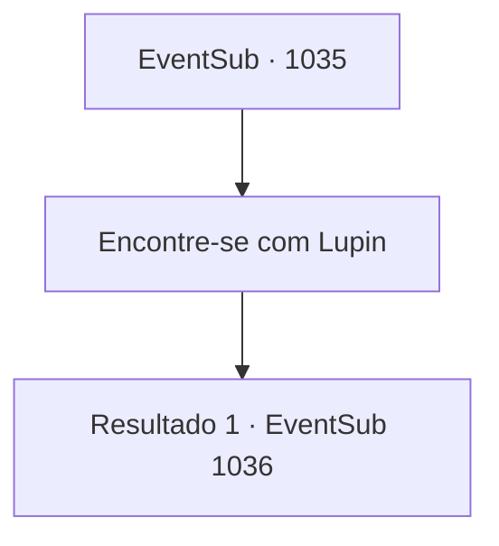

# Eventos secundários · 1035

[Índice da tabela](index.md) · [Índice geral](../index.md)

ID: `pt:EventSub:1035` · Fonte: `EventSub4` · Versão: 1.2.47.

Mapeamento estático dos arquivos; a disponibilidade e a execução dependem do estado da run.

## Texto do evento

*Sem texto no arquivo.*

## Dados de entrada

```json
{
  "id": 1035,
  "grade": 1,
  "subEvent": "",
  "required": ""
}
```

## Mapa das escolhas



## Escolhas e resultados

### Escolha 1

Encontre-se com Lupin

Requisitos e outros campos da escolha:

```json
{
  "required": ""
}
```

#### Resultado 1.1

Você retorna a Lupin com o testemunho de um avistamento de mantícora. 

 "Alguma novidade?"

 Você conta a ele sobre o avistamento da mantícora. Lupin acena em resposta. 

 "Entendo. Na verdade, ouvi algo muito semelhante. Sobre uma mantícora se banhando na lama nas colinas próximas. Vamos, então. Acho que é seguro presumir que realmente há uma mantícora lá."

 Você e Lupin se dirigem para as colinas atrás da cidade. Enquanto vocês estão subindo as colinas, encontram a carcaça de um cervo, mutilada sem piedade. 

 "Este deve ser o trabalho daquela mantícora... Ela nem se alimentou - está matando por esporte."

 Lupin examina os ferimentos no cervo, aproximando o tamanho da mantícora. 

 "A carcaça ainda está quente. E note aqui as marcas de arranhões - uma grande, sem dúvida. É melhor ter cuidado."

 Assim que ele termina, um rugido gutural ecoa pela floresta. Instintivamente, você se vira para os arbustos. Seus olhos se encontram com os de uma mantícora, silenciosamente perseguindo sua presa através da folhagem.

Continuação registrada: [Evento 1036](1036.md) na mesma tabela.

```json
{
  "required": "",
  "chance": "1",
  "nextEvent": 1036,
  "type": 2,
  "reward": ""
}
```

## Referências que chegam a este evento

- [Evento 1034 · escolha 2 · resultado 1](1034.md#escolha-2)
- [Evento 1034 · escolha 3 · resultado 1](1034.md#escolha-3)
