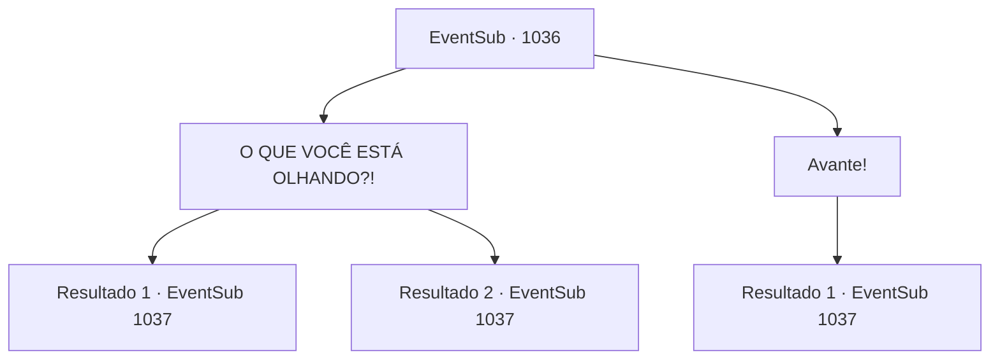

# Eventos secundários · 1036

[Índice da tabela](index.md) · [Índice geral](../index.md)

ID: `pt:EventSub:1036` · Fonte: `EventSub4` · Versão: 1.2.47.

Mapeamento estático dos arquivos; a disponibilidade e a execução dependem do estado da run.

## Texto do evento

*Sem texto no arquivo.*

## Dados de entrada

```json
{
  "id": 1036,
  "grade": 1,
  "subEvent": "",
  "required": ""
}
```

## Mapa das escolhas



## Escolhas e resultados

### Escolha 1

O QUE VOCÊ ESTÁ OLHANDO?!

Requisitos e outros campos da escolha:

```json
{
  "required": ""
}
```

#### Resultado 1.1

Você grita com a manticora. A besta se encolhe, dando um passo para trás. Lupin percebe uma abertura, salta sobre a manticora e a apunhala com sua espada. 

 "GRR-ROARRRR--!"

 A manticora solta um grito doloroso, então ataca você e Lupin.

Continuação registrada: [Evento 1037](1037.md) na mesma tabela.

```json
{
  "required": "",
  "chance": "1|0_12_1",
  "nextEvent": 1037,
  "type": 0,
  "reward": "6_2_96",
  "place": 1
}
```

#### Resultado 1.2

Você grita com a manticora. Isso agita a besta, que salta sobre você imediatamente.

Continuação registrada: [Evento 1037](1037.md) na mesma tabela.

```json
{
  "required": "",
  "chance": "20",
  "nextEvent": 1037,
  "type": 1,
  "reward": "6_0_96",
  "place": 1
}
```

### Escolha 2

Avante!

Requisitos e outros campos da escolha:

```json
{
  "required": ""
}
```

#### Resultado 2.1

Você confronta a manticora. Parece aceitar seu desafio, enquanto emerge dos arbustos, revelando suas garras ensanguentadas.

Continuação registrada: [Evento 1037](1037.md) na mesma tabela.

```json
{
  "required": "",
  "chance": "1",
  "nextEvent": 1037,
  "type": 2,
  "reward": "6_0_96",
  "place": 1
}
```

## Referências que chegam a este evento

- [Evento 1035 · escolha 1 · resultado 1](1035.md#escolha-1)
