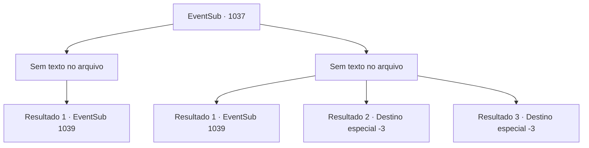

# Eventos secundários · 1037

[Índice da tabela](index.md) · [Índice geral](../index.md)

ID: `pt:EventSub:1037` · Fonte: `EventSub4` · Versão: 1.2.47.

Mapeamento estático dos arquivos; a disponibilidade e a execução dependem do estado da run.

## Texto do evento

*Sem texto no arquivo.*

## Dados de entrada

```json
{
  "id": 1037,
  "grade": 1,
  "subEvent": "",
  "required": ""
}
```

## Mapa das escolhas



## Escolhas e resultados

### Escolha 1

*Sem texto no arquivo; o papel dessa opção depende da interface do jogo.*

Requisitos e outros campos da escolha:

```json
{
  "required": ""
}
```

#### Resultado 1.1

Você e Lupin conseguem derrubar a manticora e obter sua cauda. Ele elogia você pelo trabalho realizado. 

 "Isso não teria sido possível sozinho. Ótimo trabalho - vamos voltar agora."

 Lupin assume a liderança, e você o segue de volta ao castelo do Conde. |drawing_Rouent| Você retorna ao quarto de Edward. Sua condição parece ter piorado - ele parece ainda mais magro e exausto do que antes. Lupin se vira para você e fala. 

 "Vamos começar."

 Ele então lhe entrega uma bolsa, dentro da qual está a cauda da manticora.

Continuação registrada: [Evento 1039](1039.md) na mesma tabela.

```json
{
  "required": "",
  "chance": "1",
  "nextEvent": 1039,
  "type": 2,
  "reward": ""
}
```

### Escolha 2

*Sem texto no arquivo; o papel dessa opção depende da interface do jogo.*

Requisitos e outros campos da escolha:

```json
{
  "required": ""
}
```

#### Resultado 2.1

A manticora te derruba no chão com suas patas. Sua cauda está prestes a te picar, mas Lupin intervém e a corta. 

 "GROOOAR! *GRRRRR*"

 A manticora foge, gritando. Lupin te ajuda a se levantar. 

 "Bom trabalho. Vamos voltar agora."

 Lupin toma a dianteira, e você o segue de volta ao castelo do Conde. |drawing_Rouent| Você retorna ao quarto de Edward. Sua condição parece ter piorado - ele parece ainda mais magro e exausto do que antes. Lupin se vira para você e fala. 

 "Vamos começar."

 Ele então te entrega uma bolsa, dentro da qual está a cauda da manticora.

Continuação registrada: [Evento 1039](1039.md) na mesma tabela.

```json
{
  "required": "1_0_2|1_1_2",
  "chance": "1",
  "nextEvent": 1039,
  "type": 2,
  "reward": "0_0_-1|0_1_-1"
}
```

#### Resultado 2.2

A manticora te derruba no chão com suas patas. Sua cauda perfura seu corpo e injeta veneno letal. Você sente sua consciência se esvaindo.

Continuação registrada: [Destino especial `-3`](../destinos-especiais.md).

```json
{
  "required": "2_0_2",
  "chance": "1",
  "nextEvent": -3,
  "type": 2,
  "reward": "0_0_-1|0_1_-1"
}
```

#### Resultado 2.3

A manticora te derruba no chão com suas patas. Sua cauda perfura seu corpo e injeta veneno letal. Você sente sua consciência se esvaindo.

Continuação registrada: [Destino especial `-3`](../destinos-especiais.md).

```json
{
  "required": "2_1_2",
  "chance": "1",
  "nextEvent": -3,
  "type": 2,
  "reward": "0_0_-1|0_1_-1"
}
```

## Referências que chegam a este evento

- [Evento 1036 · escolha 1 · resultado 1](1036.md#escolha-1)
- [Evento 1036 · escolha 1 · resultado 2](1036.md#escolha-1)
- [Evento 1036 · escolha 2 · resultado 1](1036.md#escolha-2)
