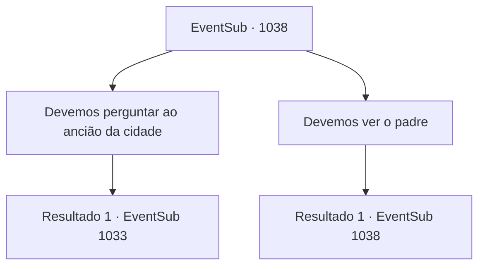

# Eventos secundários · 1038

[Índice da tabela](index.md) · [Índice geral](../index.md)

ID: `pt:EventSub:1038` · Fonte: `EventSub4` · Versão: 1.2.47.

Mapeamento estático dos arquivos; a disponibilidade e a execução dependem do estado da run.

## Texto do evento

*Sem texto no arquivo.*

## Dados de entrada

```json
{
  "id": 1038,
  "grade": 1,
  "subEvent": "",
  "required": ""
}
```

## Mapa das escolhas



## Escolhas e resultados

### Escolha 1

Devemos perguntar ao ancião da cidade

Requisitos e outros campos da escolha:

```json
{
  "required": ""
}
```

#### Resultado 1.1

Os locais falavam da mulher mais velha e sábia da cidade. Ela está sentada em uma poltrona dentro de uma cabana desgastada perto dos arredores da cidade, olhando para a paisagem da cidade. 

 "Hm...? O que você possivelmente poderia querer de uma velha como eu?"

 Lupin se aproxima da velha educadamente e pergunta. 

 "Com licença. Meu nome é Lupin, um cavaleiro que serve ao Conde Ronan."

 Ele tira o documento e mostra para a velha. 

 "Poderia me ajudar a decifrar o conteúdo escrito neste pergaminho?"

 Ela deve estar sofrendo de hipermetropia - ela coloca o documento nas mãos e o afasta o máximo possível, mas parece que ainda não consegue lê-lo claramente. Finalmente, Lupin pega o pergaminho em suas mãos e começa a se afastar da velha, lentamente. 

 "Ah. Finalmente! Vamos ver... 'Desenhe um círculo com pó de osso fino. Desenhe um diamante que inscreva o círculo com sangue. Começando do norte, no sentido anti-horário, coloque um crânio, perna dianteira de um bode, perna de uma aranha gigante e um rabo de manticora. Para desfazer a maldição, repita o ritual ao contrário.' É o que está escrito."

 Lupin agradece a velha repetidamente. 

 "Muito obrigado."

 Lupin retorna feliz para você. 

 "Vamos voltar para as Catacumbas por enquanto, para reunir os ingredientes lá."

 Você e Lupin retornam à câmara do ritual e obtêm os ingredientes restantes. 

 "Hm... Um pouco desidratados, mas ainda utilizáveis. Lukas deve ter preparado um excedente. Mas quanto ao rabo de manticora... Teremos que encontrar um novo."

 Lupin murmura, cuidadosamente sacudindo o rabo de manticora quebrado com o pé.

Continuação registrada: [Evento 1033](1033.md) na mesma tabela.

```json
{
  "required": "",
  "chance": "1",
  "nextEvent": 1033,
  "type": 2,
  "reward": ""
}
```

### Escolha 2

Devemos ver o padre

Requisitos e outros campos da escolha:

```json
{
  "required": "5_808_0"
}
```

#### Resultado 2.1

Você sai das Catacumbas e se dirige à igreja mais próxima. Dentro de uma igreja antiga e em ruínas, está sentado um velho padre, rezando. Lupin se aproxima do padre e pergunta educadamente. 

 "Com licença. Meu nome é Lupin, um cavaleiro que serve o Conde Ronan."

 Ele tira o documento e o mostra ao velho padre. 

 "Poderia me ajudar a decifrar o conteúdo escrito neste pergaminho?"

 Mas os olhos do padre estão completamente vazios. 

 "Sinto muito. Não acho que isso seja possível..."

 Lupin se desculpa imediatamente, assustado. 

 "M- minhas desculpas!!"

 Apesar de ter sido informado de que o padre é cego, Lupin se inclina para o padre ao sair, percebendo o quão rude ele pode ter soado. 

 "Bem. Eu certamente não esperava por isso. O ancião da cidade - vamos tentar o ancião da cidade."


Continuação registrada: [Evento 1038](1038.md) na mesma tabela.

```json
{
  "required": "",
  "chance": "1",
  "nextEvent": 1038,
  "type": 2,
  "reward": "5_808_1"
}
```

## Referências que chegam a este evento

- [Evento 1032 · escolha 2 · resultado 2](1032.md#escolha-2)
- [Evento 1038 · escolha 2 · resultado 1](1038.md#escolha-2)
