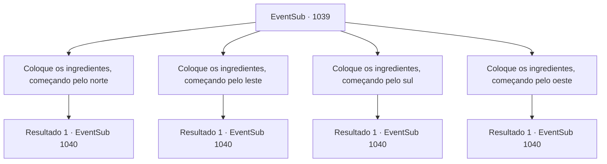

# Eventos secundários · 1039

[Índice da tabela](index.md) · [Índice geral](../index.md)

ID: `pt:EventSub:1039` · Fonte: `EventSub4` · Versão: 1.2.47.

Mapeamento estático dos arquivos; a disponibilidade e a execução dependem do estado da run.

## Texto do evento

*Sem texto no arquivo.*

## Dados de entrada

```json
{
  "id": 1039,
  "grade": 1,
  "subEvent": "",
  "required": ""
}
```

## Mapa das escolhas



## Escolhas e resultados

### Escolha 1

Coloque os ingredientes, começando pelo norte

Requisitos e outros campos da escolha:

```json
{
  "required": ""
}
```

#### Resultado 1.1

Você coloca a cauda do manticore no norte. Depois de verificar que o ingrediente está no lugar, Lupin lhe entrega o próximo ingrediente. 

 "Aqui - a perna de uma aranha gigante."

 Você coloca os ingredientes - perna de uma aranha gigante, perna dianteira de um bode e, finalmente, um crânio - no sentido horário. Lupin continua. 

 "Certo. Agora... quanto ao círculo mágico."

 Ele lhe entrega uma garrafa, cheia de sangue.

Continuação registrada: [Evento 1040](1040.md) na mesma tabela.

```json
{
  "required": "",
  "chance": "1",
  "nextEvent": 1040,
  "type": 2,
  "reward": "5_809_9"
}
```

### Escolha 2

Coloque os ingredientes, começando pelo leste

Requisitos e outros campos da escolha:

```json
{
  "required": ""
}
```

#### Resultado 2.1

Você coloca a cauda do manticore no leste. Depois de verificar que o ingrediente está no lugar, Lupin lhe entrega o próximo ingrediente. 

 "Aqui - a perna de uma aranha gigante."

 Você coloca os ingredientes - perna de uma aranha gigante, perna dianteira de um bode e, finalmente, um crânio - no sentido horário. Lupin continua. 

 "Certo. Agora... quanto ao círculo mágico."

 Ele lhe entrega uma garrafa, cheia de sangue.

Continuação registrada: [Evento 1040](1040.md) na mesma tabela.

```json
{
  "required": "",
  "chance": "1",
  "nextEvent": 1040,
  "type": 2,
  "reward": "5_809_1"
}
```

### Escolha 3

Coloque os ingredientes, começando pelo sul

Requisitos e outros campos da escolha:

```json
{
  "required": ""
}
```

#### Resultado 3.1

Você coloca a cauda do manticore no sul. Depois de verificar que o ingrediente está no lugar, Lupin lhe entrega o próximo ingrediente. 

 "Aqui - a perna de uma aranha gigante."

 Você coloca os ingredientes - perna de uma aranha gigante, perna dianteira de um bode e, finalmente, um crânio - no sentido horário. Lupin continua. 

 "Certo. Agora... quanto ao círculo mágico."

 Ele lhe entrega uma garrafa, cheia de sangue.

Continuação registrada: [Evento 1040](1040.md) na mesma tabela.

```json
{
  "required": "",
  "chance": "1",
  "nextEvent": 1040,
  "type": 2,
  "reward": "5_809_9"
}
```

### Escolha 4

Coloque os ingredientes, começando pelo oeste

Requisitos e outros campos da escolha:

```json
{
  "required": ""
}
```

#### Resultado 4.1

Você coloca a cauda do manticore no oeste. Depois de verificar que o ingrediente está no lugar, Lupin lhe entrega o próximo ingrediente. 

 "Aqui - a perna de uma aranha gigante."

 Você coloca os ingredientes - perna de uma aranha gigante, perna dianteira de um bode e, finalmente, um crânio - no sentido horário. Lupin continua. 

 "Certo. Agora... quanto ao círculo mágico."

 Ele lhe entrega uma garrafa, cheia de sangue.

Continuação registrada: [Evento 1040](1040.md) na mesma tabela.

```json
{
  "required": "",
  "chance": "1",
  "nextEvent": 1040,
  "type": 2,
  "reward": "5_809_9"
}
```

## Referências que chegam a este evento

- [Evento 1037 · escolha 1 · resultado 1](1037.md#escolha-1)
- [Evento 1037 · escolha 2 · resultado 1](1037.md#escolha-2)
