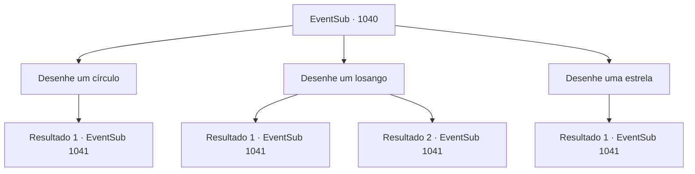

# Eventos secundários · 1040

[Índice da tabela](index.md) · [Índice geral](../index.md)

ID: `pt:EventSub:1040` · Fonte: `EventSub4` · Versão: 1.2.47.

Mapeamento estático dos arquivos; a disponibilidade e a execução dependem do estado da run.

## Texto do evento

*Sem texto no arquivo.*

## Dados de entrada

```json
{
  "id": 1040,
  "grade": 1,
  "subEvent": "",
  "required": ""
}
```

## Mapa das escolhas



## Escolhas e resultados

### Escolha 1

Desenhe um círculo

Requisitos e outros campos da escolha:

```json
{
  "required": ""
}
```

#### Resultado 1.1

Você cuidadosamente derrama sangue no chão, desenhando um círculo para conectar os ingredientes. Lupin observa o ritual e murmura para si mesmo. 

 "Se isso não é um ritual que grita sinistro e maligno, eu não sei o que é. Combina com Lukas, eu acho... Certo, agora o passo final."

 Ele te entrega uma bolsa de pó de ossos.

Continuação registrada: [Evento 1041](1041.md) na mesma tabela.

```json
{
  "required": "",
  "chance": "1",
  "nextEvent": 1041,
  "type": 2,
  "reward": "5_809_9"
}
```

### Escolha 2

Desenhe um losango

Requisitos e outros campos da escolha:

```json
{
  "required": ""
}
```

#### Resultado 2.1

Você cuidadosamente derrama sangue no chão, desenhando um losango para conectar os ingredientes. Lupin observa o ritual e murmura para si mesmo. 

 "Se isso não é um ritual que grita sinistro e maligno, eu não sei o que é. Combina com Lukas, eu acho... Certo, agora o passo final."

 Ele te entrega uma bolsa de pó de ossos.

Continuação registrada: [Evento 1041](1041.md) na mesma tabela.

```json
{
  "required": "5_809_1",
  "chance": "1",
  "nextEvent": 1041,
  "type": 2,
  "reward": "5_809_1"
}
```

#### Resultado 2.2

Você cuidadosamente derrama sangue no chão, desenhando um losango para conectar os ingredientes. Lupin observa o ritual e murmura para si mesmo. 

 "Se isso não é um ritual que grita sinistro e maligno, eu não sei o que é. Combina com Lukas, eu acho... Certo, agora o passo final."

 Ele te entrega uma bolsa de pó de ossos.

Continuação registrada: [Evento 1041](1041.md) na mesma tabela.

```json
{
  "required": "18_809_1",
  "chance": "1",
  "nextEvent": 1041,
  "type": 2,
  "reward": "5_809_9"
}
```

### Escolha 3

Desenhe uma estrela

Requisitos e outros campos da escolha:

```json
{
  "required": ""
}
```

#### Resultado 3.1

Você cuidadosamente derrama sangue no chão, desenhando uma estrela para conectar os ingredientes. Lupin observa o ritual e murmura para si mesmo. 

 "Se isso não é um ritual que grita sinistro e maligno, eu não sei o que é. Combina com Lukas, eu acho... Certo, agora o passo final."

 Ele te entrega uma bolsa de pó de ossos.

Continuação registrada: [Evento 1041](1041.md) na mesma tabela.

```json
{
  "required": "",
  "chance": "1",
  "nextEvent": 1041,
  "type": 2,
  "reward": "5_809_9"
}
```

## Referências que chegam a este evento

- [Evento 1039 · escolha 1 · resultado 1](1039.md#escolha-1)
- [Evento 1039 · escolha 2 · resultado 1](1039.md#escolha-2)
- [Evento 1039 · escolha 3 · resultado 1](1039.md#escolha-3)
- [Evento 1039 · escolha 4 · resultado 1](1039.md#escolha-4)
