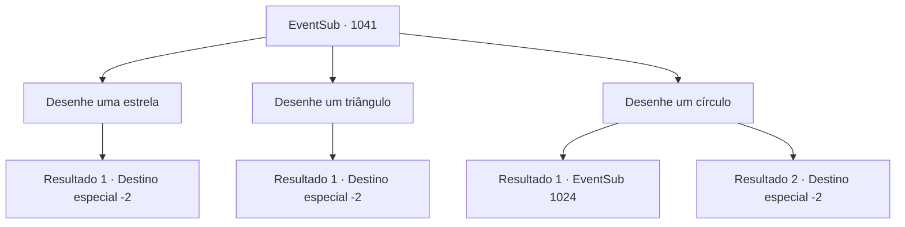

# Eventos secundários · 1041

[Índice da tabela](index.md) · [Índice geral](../index.md)

ID: `pt:EventSub:1041` · Fonte: `EventSub4` · Versão: 1.2.47.

Mapeamento estático dos arquivos; a disponibilidade e a execução dependem do estado da run.

## Texto do evento

*Sem texto no arquivo.*

## Dados de entrada

```json
{
  "id": 1041,
  "grade": 1,
  "subEvent": "",
  "required": ""
}
```

## Mapa das escolhas



## Escolhas e resultados

### Escolha 1

Desenhe uma estrela

Requisitos e outros campos da escolha:

```json
{
  "required": ""
}
```

#### Resultado 1.1

Você cuidadosamente desenha uma estrela com pó de ossos, encerrando o ritual reverso. Mas nada acontece. Edward ainda parece estar amaldiçoado. 

 "Hmm..."

 Lupin suspira e coça a cabeça. 

 "Algo deve ter dado errado... Será que esquecemos algum ingrediente? Ou talvez esse ritual fosse falso desde o início...?"

 Ele parece estar perdido em pensamentos por alguns minutos. Então, ele se vira para você e fala. 

 "Não tenho certeza. Mas... nós tentamos. Tentamos tudo dentro de nossas capacidades. Obrigado por ajudar."

 Lupin reconhece seu papel em chegar até aqui, então esvazia seus bolsos para lhe entregar o ouro que saiu. 

 "Que sua jornada leve à fortuna."

 Você se despede do cavaleiro e então deixa o castelo de Ronan.

Continuação registrada: [Destino especial `-2`](../destinos-especiais.md).

```json
{
  "required": "",
  "chance": "1",
  "nextEvent": -2,
  "type": 2,
  "reward": "12_12_-1|0_4_150|14_12_9"
}
```

### Escolha 2

Desenhe um triângulo

Requisitos e outros campos da escolha:

```json
{
  "required": ""
}
```

#### Resultado 2.1

Você cuidadosamente desenha um triângulo com pó de osso, encerrando o ritual reverso. Mas nada acontece. Edward ainda parece estar amaldiçoado. 

 "Hmm..."

 Lupin suspira e coça a cabeça. 

 "Algo deve ter dado errado... Será que esquecemos algum ingrediente? Ou talvez esse ritual fosse falso desde o início...?"

 Ele parece estar perdido em pensamentos por alguns minutos. Então, ele se vira para você e fala. 

 "Não tenho certeza. Mas... nós tentamos. Tentamos tudo dentro de nossas capacidades. Obrigado por ajudar."

 Lupin reconhece seu papel em chegar até aqui, então esvazia seus bolsos para lhe entregar o ouro que saiu. 

 "Que sua jornada leve à fortuna."

 Você se despede do cavaleiro e então deixa o castelo de Ronan.

Continuação registrada: [Destino especial `-2`](../destinos-especiais.md).

```json
{
  "required": "",
  "chance": "1",
  "nextEvent": -2,
  "type": 2,
  "reward": "12_12_-1|0_4_150|14_12_9"
}
```

### Escolha 3

Desenhe um círculo

Requisitos e outros campos da escolha:

```json
{
  "required": ""
}
```

#### Resultado 3.1

Você desenha cuidadosamente um círculo com pó de ossos, encerrando o ritual reverso. Então, o diamante de sangue, o círculo de pó de ossos e os ingredientes começam a emitir um brilho vermelho-escuro. Logo, com um som que você ouviria de vidro se quebrando, os espíritos malignos que estavam presos dentro de Edward são liberados. 

 "O- onde estou?"

 Lupin abraça Edward em resposta. 

 "Estamos em casa, Jovem Mestre Edward."

 Lupin se vira para você, sorrindo. 

 "Então funcionou. Fique aqui por um segundo. Vou avisar o Conde."

 O cavaleiro então sai da sala para chamar Ronan. Você espera por alguns minutos, cuidando de Edward. Logo, o Conde Ronan e suas duas esposas entram na sala apressadamente. A Condessa de cabelos brancos cai em lágrimas e abraça o menino. 

 "Ed...! MEU FILHO...!!"

 Ela parece ter esquecido sua posição como Condessa. Sua maquiagem está toda borrada pelas lágrimas, abraçando seu filho com força. Edward parece confuso com tudo, mas ainda assim retribui o abraço da mãe. O Conde se junta, com os olhos marejados. Logo, ele percebe sua presença novamente e recupera a compostura. 

 "Ahem... Se nos der licença por um segundo."

 Ele sai com a Condessa e Edward, escoltando-os para outra sala. A outra esposa do Conde observa a cena em silêncio. Algo parece estar preocupando-a.

Continuação registrada: [Evento 1024](1024.md) na mesma tabela.

```json
{
  "required": "5_809_1",
  "chance": "1",
  "nextEvent": 1024,
  "type": 2,
  "reward": ""
}
```

#### Resultado 3.2

Você cuidadosamente desenha um círculo com pó de ossos, encerrando o ritual reverso. Mas nada acontece. Edward ainda parece estar amaldiçoado. 

 "Hmm..."

 Lupin suspira e coça a cabeça. 

 "Algo deve ter dado errado... Será que esquecemos algum ingrediente? Ou talvez esse ritual fosse falso desde o início...?"

 Ele parece perdido em pensamentos por alguns minutos. Então, ele se vira para você e fala. 

 "Não tenho certeza. Mas... nós tentamos. Tentamos tudo dentro de nossas capacidades. Obrigado por ajudar."

 Lupin reconhece seu papel em chegar até aqui, então esvazia os bolsos para lhe entregar o ouro que saiu. 

 "Que sua jornada leve à fortuna."

 Você se despede do cavaleiro e deixa o castelo de Ronan.

Continuação registrada: [Destino especial `-2`](../destinos-especiais.md).

```json
{
  "required": "18_809_1",
  "chance": "1",
  "nextEvent": -2,
  "type": 2,
  "reward": "12_12_-1|0_4_150|14_12_9"
}
```

## Referências que chegam a este evento

- [Evento 1040 · escolha 1 · resultado 1](1040.md#escolha-1)
- [Evento 1040 · escolha 2 · resultado 1](1040.md#escolha-2)
- [Evento 1040 · escolha 2 · resultado 2](1040.md#escolha-2)
- [Evento 1040 · escolha 3 · resultado 1](1040.md#escolha-3)
